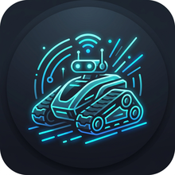
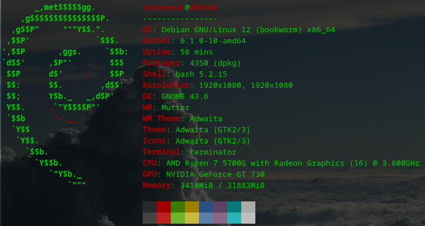
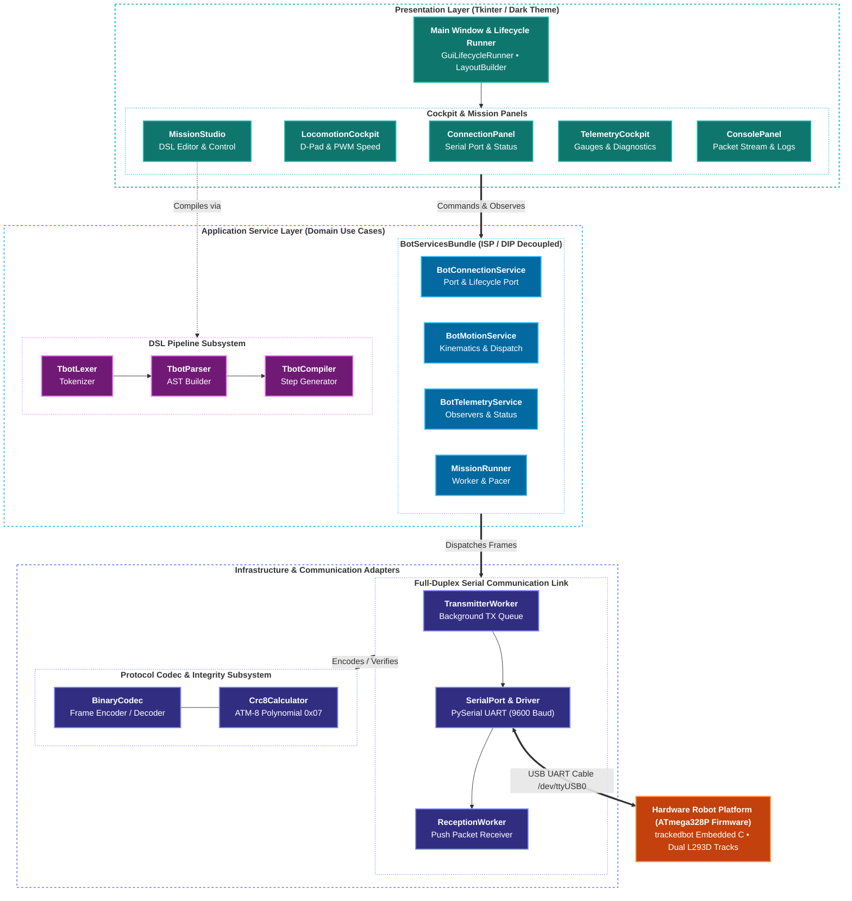
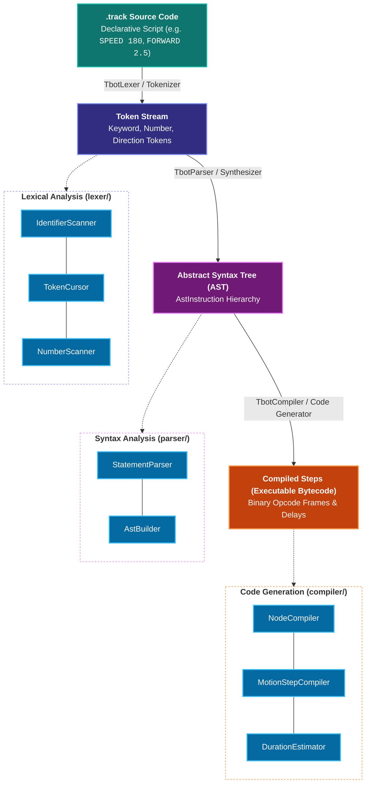
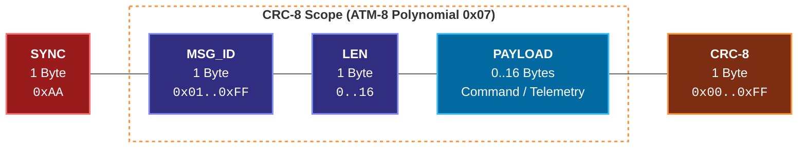
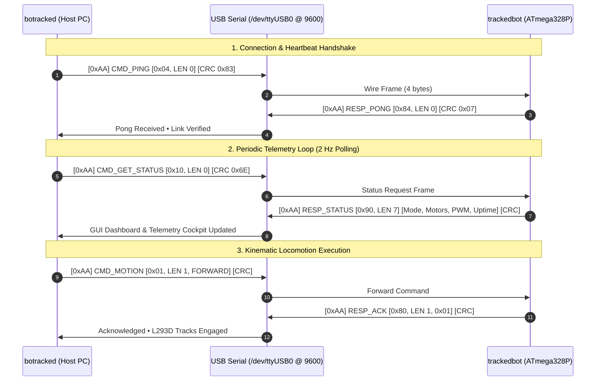
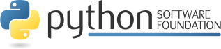

# Tracked Robot Control Studio & Telemetry Monitor



**botracked** is a modular Python desktop application, telemetry monitor, and mission scripting suite for tracked robotic platforms.

Developed in **[python](https://www.python.org/)** code.

The README is used to introduce the modules and provide instructions on
how to install the modules, any machine dependencies it may have and any
other information that should be provided before the modules are installed.

[](https://github.com/vroncevic/botracked/actions/workflows/botracked_python_checker.yml) [](https://github.com/vroncevic/botracked/actions/workflows/botracked_package_checker.yml) [](https://github.com/vroncevic/botracked/actions/workflows/botracked_interface_checker.yml) [](https://github.com/vroncevic/botracked/actions/workflows/botracked_isp_checker.yml) [](https://github.com/vroncevic/botracked/actions/workflows/botracked_srp_checker.yml) [](https://www.gnu.org/licenses/gpl-3.0) [](https://opensource.org/licenses/Apache-2.0) [](https://www.python.org/downloads/) [](https://github.com/vroncevic/botracked/issues) [](https://github.com/vroncevic/botracked/graphs/contributors)

<!-- START doctoc generated TOC please keep comment here to allow auto update -->
<!-- DON'T EDIT THIS SECTION, INSTEAD RE-RUN doctoc TO UPDATE -->
**Table of Contents**

- [🚀 Installation](#-installation)
    - [Install using pip](#install-using-pip)
    - [Install using build](#install-using-build)
    - [Install using py setup](#install-using-py-setup)
    - [Install using docker](#install-using-docker)
- [📦 Dependencies](#-dependencies)
- [📁 Tool structure](#-tool-structure)
  - [🏗 Architecture & SOLID Principles](#-architecture--solid-principles)
    - [SOLID Principles Compliance](#solid-principles-compliance)
    - [Automated Quality Gates (`run_quality_gates.sh`)](#automated-quality-gates-run_quality_gatessh)
  - [✨ Features](#-features)
  - [📜 Tracked Bot Domain-Specific Language (DSL) & `.track` Programs](#-tracked-bot-domain-specific-language-dsl--track-programs)
    - [Tracked Bot DSL Instruction Reference](#tracked-bot-dsl-instruction-reference)
    - [Example `.track` Program: Autonomous Perimeter Patrol](#example-track-program-autonomous-perimeter-patrol)
  - [📡 Binary Packet Communication Protocol & Framing](#-binary-packet-communication-protocol--framing)
    - [Command Frames (Host $\to$ Robot)](#command-frames-host-%5Cto-robot)
    - [Response Frames (Robot $\to$ Host)](#response-frames-robot-%5Cto-host)
- [📊 Code coverage](#-code-coverage)
- [🛠 Usage](#-usage)
    - [CLI Command Options](#cli-command-options)
    - [Interactive Mission Planning & Telemetry Workflow](#interactive-mission-planning--telemetry-workflow)
- [📚 Docs](#-docs)
- [👥 Contributing](#-contributing)
- [📄 Copyright and licence](#-copyright-and-licence)

<!-- END doctoc generated TOC please keep comment here to allow auto update -->

### 🚀 Installation

Used next development environment



[](https://github.com/vroncevic/botracked/actions/workflows/botracked_python3_build.yml)

Currently there are three ways to install package
* Install process based on using pip mechanism
* Install process based on build mechanism
* Install process based on setup.py mechanism
* Install process based on docker mechanism

##### Install using pip

**botracked** is located at **[pypi.org](https://pypi.org/project/botracked/)**.

You can install by using pip

```bash
# python3
pip3 install botracked
```

##### Install using build

Navigate to release **[page](https://github.com/vroncevic/botracked/releases/)** download and extract release archive.

To install **botracked** type the following

```bash
tar xvzf botracked-x.y.z.tar.gz
cd botracked-x.y.z/
# python3
wget https://bootstrap.pypa.io/get-pip.py
python3 get-pip.py 
python3 -m pip install --upgrade setuptools
python3 -m pip install --upgrade pip
python3 -m pip install --upgrade build
pip3 install -r requirements.txt
python3 -m build --no-isolation --wheel
pip3 install ./dist/botracked-*-py3-none-any.whl
rm -f get-pip.py
chmod 755 /usr/local/lib/python3.10/dist-packages/usr/local/bin/botracked_run.py
ln -s /usr/local/lib/python3.10/dist-packages/usr/local/bin/botracked_run.py /usr/local/bin/botracked_run.py
```

##### Install using py setup

Navigate to **[release page](https://github.com/vroncevic/botracked/releases)** download and extract release archive.

To install **botracked** locate and run setup.py with arguments

```bash
tar xvzf botracked-x.y.z.tar.gz
cd botracked-x.y.z
# python3
pip3 install -r requirements.txt
python3 setup.py install_lib
python3 setup.py install_egg_info
```

##### Install using docker

You can use Dockerfile to create image/container.

### 📦 Dependencies

**botracked** requires next modules and libraries

* [ats-utilities - Python App/Tool/Script Utilities](https://pypi.org/project/ats-utilities/) [](https://www.gnu.org/licenses/gpl-3.0) [](https://opensource.org/licenses/Apache-2.0)
* [pyserial - Python Serial Port Extension](https://pypi.org/project/pyserial/) [](https://opensource.org/licenses/BSD-3-Clause)

### 📁 Tool structure

**botracked** is based on OOP and Clean Architecture.

Tool structure

<details>
<summary><b>Click to expand framework structure</b></summary>

```bash
    botracked/
         ├── core/
         │   ├── __init__.py
         │   ├── model/
         │   │   ├── connection_params.py
         │   │   ├── connection_preference.py
         │   │   ├── dsl/
         │   │   │   ├── ast_instruction.py
         │   │   │   ├── compiled_step.py
         │   │   │   ├── __init__.py
         │   │   │   ├── token.py
         │   │   │   └── token_type.py
         │   │   ├── exceptions/
         │   │   │   ├── botracked_error.py
         │   │   │   ├── codec_error.py
         │   │   │   ├── connection_error.py
         │   │   │   ├── dsl_error.py
         │   │   │   ├── dsl_syntax_error.py
         │   │   │   ├── port_disconnected_error.py
         │   │   │   ├── preferences_error.py
         │   │   │   ├── preset_error.py
         │   │   │   ├── queue_empty_error.py
         │   │   │   ├── receiver_error.py
         │   │   │   └── transmitter_error.py
         │   │   ├── __init__.py
         │   │   ├── motion_command.py
         │   │   ├── motor_state.py
         │   │   ├── packet_direction.py
         │   │   ├── protocol_opcode.py
         │   │   ├── system_mode.py
         │   │   └── telemetry_data.py
         │   └── service/
         │       ├── bundle/
         │       │   ├── __init__.py
         │       │   ├── runners.py
         │       │   ├── runtime.py
         │       │   └── services.py
         │       ├── codec/
         │       │   ├── crc/
         │       │   │   ├── icalculator.py
         │       │   │   └── __init__.py
         │       │   ├── icodec.py
         │       │   └── __init__.py
         │       ├── concurrency/
         │       │   ├── iclock.py
         │       │   ├── icontroller.py
         │       │   ├── iflag.py
         │       │   ├── __init__.py
         │       │   ├── irunnable.py
         │       │   └── irunner.py
         │       ├── connection/
         │       │   ├── buffer/
         │       │   │   ├── __init__.py
         │       │   │   └── iqueue.py
         │       │   ├── dependencies.py
         │       │   ├── dispatcher/
         │       │   │   ├── dependencies.py
         │       │   │   ├── dispatcher.py
         │       │   │   ├── factory.py
         │       │   │   ├── idispatcher.py
         │       │   │   ├── __init__.py
         │       │   │   └── provides.py
         │       │   ├── factory.py
         │       │   ├── __init__.py
         │       │   ├── iservice.py
         │       │   ├── port/
         │       │   │   ├── __init__.py
         │       │   │   ├── iport.py
         │       │   │   └── istatus.py
         │       │   ├── preferences/
         │       │   │   ├── __init__.py
         │       │   │   └── irepository.py
         │       │   ├── provides.py
         │       │   ├── receiver/
         │       │   │   ├── dependencies.py
         │       │   │   ├── factory.py
         │       │   │   ├── __init__.py
         │       │   │   ├── protocol/
         │       │   │   │   ├── __init__.py
         │       │   │   │   ├── ireader.py
         │       │   │   │   └── ireceiver.py
         │       │   │   ├── provides.py
         │       │   │   └── task.py
         │       │   ├── scanner/
         │       │   │   ├── __init__.py
         │       │   │   └── iscanner.py
         │       │   ├── service.py
         │       │   ├── transmitter/
         │       │   │   ├── dependencies.py
         │       │   │   ├── factory.py
         │       │   │   ├── __init__.py
         │       │   │   ├── protocol/
         │       │   │   │   ├── __init__.py
         │       │   │   │   ├── itransmitter.py
         │       │   │   │   └── iwriter.py
         │       │   │   ├── provides.py
         │       │   │   └── task.py
         │       │   └── worker/
         │       │       ├── dependencies.py
         │       │       ├── factory.py
         │       │       ├── __init__.py
         │       │       ├── iworker.py
         │       │       ├── loop/
         │       │       │   ├── iloop.py
         │       │       │   ├── __init__.py
         │       │       │   └── loop.py
         │       │       ├── provides.py
         │       │       ├── task/
         │       │       │   ├── __init__.py
         │       │       │   ├── itask.py
         │       │       │   └── task.py
         │       │       └── worker.py
         │       ├── dsl/
         │       │   ├── compiler/
         │       │   │   ├── compiler.py
         │       │   │   ├── dependencies.py
         │       │   │   ├── estimator/
         │       │   │   │   ├── estimator.py
         │       │   │   │   ├── iestimator.py
         │       │   │   │   └── __init__.py
         │       │   │   ├── factory.py
         │       │   │   ├── icompiler.py
         │       │   │   ├── __init__.py
         │       │   │   ├── motion/
         │       │   │   │   ├── imotion.py
         │       │   │   │   ├── __init__.py
         │       │   │   │   └── motion.py
         │       │   │   ├── node/
         │       │   │   │   ├── __init__.py
         │       │   │   │   ├── inode.py
         │       │   │   │   ├── node.py
         │       │   │   │   └── state.py
         │       │   │   └── provides.py
         │       │   ├── dependencies.py
         │       │   ├── factory.py
         │       │   ├── __init__.py
         │       │   ├── iservice.py
         │       │   ├── lexer/
         │       │   │   ├── factory.py
         │       │   │   ├── identifier/
         │       │   │   │   ├── identifier.py
         │       │   │   │   ├── iidentifier.py
         │       │   │   │   └── __init__.py
         │       │   │   ├── ilexer.py
         │       │   │   ├── __init__.py
         │       │   │   ├── lexer.py
         │       │   │   ├── number/
         │       │   │   │   ├── __init__.py
         │       │   │   │   ├── inumber.py
         │       │   │   │   └── number.py
         │       │   │   └── provides.py
         │       │   ├── parser/
         │       │   │   ├── cursor/
         │       │   │   │   ├── cursor.py
         │       │   │   │   ├── icursor.py
         │       │   │   │   └── __init__.py
         │       │   │   ├── factory.py
         │       │   │   ├── __init__.py
         │       │   │   ├── iparser.py
         │       │   │   ├── parser.py
         │       │   │   ├── provides.py
         │       │   │   └── statement/
         │       │   │       ├── __init__.py
         │       │   │       ├── istatement.py
         │       │   │       └── statement.py
         │       │   ├── preset/
         │       │   │   ├── __init__.py
         │       │   │   └── irepository.py
         │       │   ├── provides.py
         │       │   └── service.py
         │       ├── __init__.py
         │       ├── motion/
         │       │   ├── dependencies.py
         │       │   ├── factory.py
         │       │   ├── __init__.py
         │       │   ├── iservice.py
         │       │   ├── protocol/
         │       │   │   ├── iactuator.py
         │       │   │   └── __init__.py
         │       │   ├── provides.py
         │       │   ├── runner/
         │       │   │   ├── dependencies.py
         │       │   │   ├── factory.py
         │       │   │   ├── __init__.py
         │       │   │   ├── irunner.py
         │       │   │   ├── pacer/
         │       │   │   │   ├── dependencies.py
         │       │   │   │   ├── factory.py
         │       │   │   │   ├── __init__.py
         │       │   │   │   ├── ipacer.py
         │       │   │   │   ├── pacer.py
         │       │   │   │   └── provides.py
         │       │   │   ├── provides.py
         │       │   │   ├── runner.py
         │       │   │   └── worker/
         │       │   │       ├── dependencies.py
         │       │   │       ├── factory.py
         │       │   │       ├── __init__.py
         │       │   │       ├── iworker.py
         │       │   │       ├── provides.py
         │       │   │       └── worker.py
         │       │   └── service.py
         │       └── telemetry/
         │           ├── factory.py
         │           ├── __init__.py
         │           ├── inspector/
         │           │   ├── dependencies.py
         │           │   ├── factory.py
         │           │   ├── iinspector.py
         │           │   ├── __init__.py
         │           │   ├── inspector.py
         │           │   └── provides.py
         │           ├── iservice.py
         │           ├── listener/
         │           │   ├── decoder/
         │           │   │   ├── decoder.py
         │           │   │   ├── idecoder.py
         │           │   │   └── __init__.py
         │           │   ├── dependencies.py
         │           │   ├── factory.py
         │           │   ├── ilistener.py
         │           │   ├── __init__.py
         │           │   ├── listener.py
         │           │   ├── loop/
         │           │   │   ├── iloop.py
         │           │   │   ├── __init__.py
         │           │   │   └── loop.py
         │           │   └── provides.py
         │           ├── poller/
         │           │   ├── dependencies.py
         │           │   ├── factory.py
         │           │   ├── __init__.py
         │           │   ├── ipoller.py
         │           │   ├── loop/
         │           │   │   ├── iloop.py
         │           │   │   ├── __init__.py
         │           │   │   └── loop.py
         │           │   ├── poller.py
         │           │   └── provides.py
         │           ├── protocol/
         │           │   ├── __init__.py
         │           │   ├── iobserver.py
         │           │   └── isink.py
         │           ├── provides.py
         │           └── service.py
         ├── engine.py
         ├── infrastructure/
         │   ├── cli/
         │   │   ├── dependencies.py
         │   │   ├── engine.py
         │   │   ├── factory.py
         │   │   ├── icli.py
         │   │   ├── __init__.py
         │   │   ├── provides.py
         │   │   └── setup/
         │   │       ├── bundle.py
         │   │       ├── dep_validator.py
         │   │       ├── dependencies.py
         │   │       ├── factory.py
         │   │       ├── __init__.py
         │   │       ├── keys.py
         │   │       ├── opt_validator.py
         │   │       ├── options.py
         │   │       ├── registry.py
         │   │       └── validator.py
         │   ├── codec/
         │   │   ├── codec.py
         │   │   ├── crc/
         │   │   │   ├── calculator.py
         │   │   │   ├── dependencies.py
         │   │   │   ├── factory.py
         │   │   │   ├── __init__.py
         │   │   │   └── provides.py
         │   │   ├── dependencies.py
         │   │   ├── factory.py
         │   │   ├── __init__.py
         │   │   └── provides.py
         │   ├── command/
         │   │   ├── bundle.py
         │   │   ├── definition.py
         │   │   ├── dependencies.py
         │   │   ├── executor.py
         │   │   ├── factory.py
         │   │   ├── idefinition.py
         │   │   ├── iexecutor.py
         │   │   ├── __init__.py
         │   │   ├── ipreloader.py
         │   │   ├── preloader.py
         │   │   └── provides.py
         │   ├── concurrency/
         │   │   ├── clock/
         │   │   │   ├── clock.py
         │   │   │   ├── factory.py
         │   │   │   ├── __init__.py
         │   │   │   └── provides.py
         │   │   ├── controller/
         │   │   │   ├── controller.py
         │   │   │   ├── dependencies.py
         │   │   │   ├── factory.py
         │   │   │   ├── __init__.py
         │   │   │   └── provides.py
         │   │   ├── flag/
         │   │   │   ├── factory.py
         │   │   │   ├── __init__.py
         │   │   │   └── provides.py
         │   │   ├── __init__.py
         │   │   └── runner/
         │   │       ├── cycle/
         │   │       │   ├── cycle.py
         │   │       │   ├── icycle.py
         │   │       │   └── __init__.py
         │   │       ├── dependencies.py
         │   │       ├── factory.py
         │   │       ├── iexecutor.py
         │   │       ├── __init__.py
         │   │       ├── provides.py
         │   │       └── runner.py
         │   ├── config/
         │   │   ├── botracked.cfg
         │   │   └── botracked.logo
         │   ├── connection/
         │   │   ├── buffer/
         │   │   │   ├── byte_queue.py
         │   │   │   ├── dependencies.py
         │   │   │   ├── factory.py
         │   │   │   ├── __init__.py
         │   │   │   ├── iraw_queue.py
         │   │   │   └── provides.py
         │   │   ├── driver/
         │   │   │   ├── control.py
         │   │   │   ├── dependencies.py
         │   │   │   ├── driver.py
         │   │   │   ├── factory.py
         │   │   │   ├── idriver.py
         │   │   │   ├── ilock.py
         │   │   │   ├── __init__.py
         │   │   │   ├── iraw_control.py
         │   │   │   ├── iraw_io.py
         │   │   │   └── provides.py
         │   │   ├── __init__.py
         │   │   ├── port/
         │   │   │   ├── dependencies.py
         │   │   │   ├── factory.py
         │   │   │   ├── __init__.py
         │   │   │   ├── provides.py
         │   │   │   └── serial.py
         │   │   ├── preferences/
         │   │   │   ├── dependencies.py
         │   │   │   ├── factory.py
         │   │   │   ├── __init__.py
         │   │   │   ├── istorage.py
         │   │   │   ├── provides.py
         │   │   │   ├── repository.py
         │   │   │   └── storage.py
         │   │   ├── receiver/
         │   │   │   ├── dependencies.py
         │   │   │   ├── factory.py
         │   │   │   ├── __init__.py
         │   │   │   ├── provides.py
         │   │   │   └── serial.py
         │   │   ├── scanner/
         │   │   │   ├── dependencies.py
         │   │   │   ├── factory.py
         │   │   │   ├── __init__.py
         │   │   │   ├── provides.py
         │   │   │   └── scanner.py
         │   │   └── transmitter/
         │   │       ├── dependencies.py
         │   │       ├── factory.py
         │   │       ├── __init__.py
         │   │       ├── provides.py
         │   │       └── serial.py
         │   ├── gui/
         │   │   ├── connection/
         │   │   │   ├── adapter/
         │   │   │   │   ├── adapter.py
         │   │   │   │   ├── dependencies.py
         │   │   │   │   ├── factory.py
         │   │   │   │   ├── __init__.py
         │   │   │   │   └── provides.py
         │   │   │   ├── dependencies.py
         │   │   │   ├── factory.py
         │   │   │   ├── idelegate.py
         │   │   │   ├── __init__.py
         │   │   │   ├── ipanel.py
         │   │   │   ├── iport_delegate.py
         │   │   │   ├── panel.py
         │   │   │   ├── provides.py
         │   │   │   ├── serial/
         │   │   │   │   ├── dependencies.py
         │   │   │   │   ├── factory.py
         │   │   │   │   ├── __init__.py
         │   │   │   │   ├── isection.py
         │   │   │   │   ├── provides.py
         │   │   │   │   └── section.py
         │   │   │   └── status/
         │   │   │       ├── dependencies.py
         │   │   │       ├── factory.py
         │   │   │       ├── ilistener.py
         │   │   │       ├── __init__.py
         │   │   │       ├── isection.py
         │   │   │       ├── provides.py
         │   │   │       └── section.py
         │   │   ├── console/
         │   │   │   ├── dependencies.py
         │   │   │   ├── factory.py
         │   │   │   ├── __init__.py
         │   │   │   ├── ipanel.py
         │   │   │   ├── observer/
         │   │   │   │   ├── ilistener.py
         │   │   │   │   ├── __init__.py
         │   │   │   │   └── isink.py
         │   │   │   ├── panel.py
         │   │   │   ├── provides.py
         │   │   │   ├── stream/
         │   │   │   │   ├── dependencies.py
         │   │   │   │   ├── factory.py
         │   │   │   │   ├── __init__.py
         │   │   │   │   ├── isection.py
         │   │   │   │   ├── provides.py
         │   │   │   │   └── section.py
         │   │   │   └── toolbar/
         │   │   │       ├── dependencies.py
         │   │   │       ├── factory.py
         │   │   │       ├── __init__.py
         │   │   │       ├── isection.py
         │   │   │       ├── provides.py
         │   │   │       └── section.py
         │   │   ├── igui.py
         │   │   ├── __init__.py
         │   │   ├── layout/
         │   │   │   ├── builder.py
         │   │   │   ├── bundle.py
         │   │   │   ├── dependencies.py
         │   │   │   ├── factory.py
         │   │   │   ├── ibuilder.py
         │   │   │   ├── __init__.py
         │   │   │   ├── provides.py
         │   │   │   └── slots.py
         │   │   ├── lifecycle/
         │   │   │   ├── dependencies.py
         │   │   │   ├── factory.py
         │   │   │   ├── __init__.py
         │   │   │   ├── irunner.py
         │   │   │   ├── provides.py
         │   │   │   └── runner.py
         │   │   ├── mission/
         │   │   │   ├── adapter/
         │   │   │   │   ├── adapter.py
         │   │   │   │   ├── dependencies.py
         │   │   │   │   ├── factory.py
         │   │   │   │   ├── __init__.py
         │   │   │   │   └── provides.py
         │   │   │   ├── dependencies.py
         │   │   │   ├── editor/
         │   │   │   │   ├── dependencies.py
         │   │   │   │   ├── factory.py
         │   │   │   │   ├── __init__.py
         │   │   │   │   ├── isection.py
         │   │   │   │   ├── provides.py
         │   │   │   │   └── section.py
         │   │   │   ├── factory.py
         │   │   │   ├── idelegate.py
         │   │   │   ├── __init__.py
         │   │   │   ├── ipanel.py
         │   │   │   ├── panel.py
         │   │   │   ├── playback/
         │   │   │   │   ├── dependencies.py
         │   │   │   │   ├── factory.py
         │   │   │   │   ├── __init__.py
         │   │   │   │   ├── isection.py
         │   │   │   │   ├── provides.py
         │   │   │   │   └── section.py
         │   │   │   ├── preset/
         │   │   │   │   ├── dependencies.py
         │   │   │   │   ├── factory.py
         │   │   │   │   ├── __init__.py
         │   │   │   │   ├── isection.py
         │   │   │   │   ├── provides.py
         │   │   │   │   └── section.py
         │   │   │   ├── provides.py
         │   │   │   ├── status/
         │   │   │   │   ├── dependencies.py
         │   │   │   │   ├── factory.py
         │   │   │   │   ├── __init__.py
         │   │   │   │   ├── isection.py
         │   │   │   │   ├── provides.py
         │   │   │   │   └── section.py
         │   │   │   ├── syntax/
         │   │   │   │   ├── config.py
         │   │   │   │   ├── dependencies.py
         │   │   │   │   ├── factory.py
         │   │   │   │   ├── highlighter/
         │   │   │   │   │   ├── highlighter.py
         │   │   │   │   │   ├── ihighlighter.py
         │   │   │   │   │   └── __init__.py
         │   │   │   │   ├── __init__.py
         │   │   │   │   ├── matcher/
         │   │   │   │   │   ├── imatcher.py
         │   │   │   │   │   ├── __init__.py
         │   │   │   │   │   └── matcher.py
         │   │   │   │   └── provides.py
         │   │   │   └── toolbar/
         │   │   │       ├── dependencies.py
         │   │   │       ├── factory.py
         │   │   │       ├── __init__.py
         │   │   │       ├── isection.py
         │   │   │       ├── provides.py
         │   │   │       └── section.py
         │   │   ├── motion/
         │   │   │   ├── adapter/
         │   │   │   │   ├── adapter.py
         │   │   │   │   ├── dependencies.py
         │   │   │   │   ├── factory.py
         │   │   │   │   ├── __init__.py
         │   │   │   │   └── provides.py
         │   │   │   ├── dependencies.py
         │   │   │   ├── dpad/
         │   │   │   │   ├── dependencies.py
         │   │   │   │   ├── factory.py
         │   │   │   │   ├── __init__.py
         │   │   │   │   ├── isection.py
         │   │   │   │   ├── provides.py
         │   │   │   │   ├── section.py
         │   │   │   │   └── trigger/
         │   │   │   │       ├── __init__.py
         │   │   │   │       ├── itrigger.py
         │   │   │   │       └── trigger.py
         │   │   │   ├── factory.py
         │   │   │   ├── idelegate.py
         │   │   │   ├── __init__.py
         │   │   │   ├── ipanel.py
         │   │   │   ├── keyboard/
         │   │   │   │   ├── controller/
         │   │   │   │   │   ├── controller.py
         │   │   │   │   │   ├── icontroller.py
         │   │   │   │   │   └── __init__.py
         │   │   │   │   ├── dependencies.py
         │   │   │   │   ├── factory.py
         │   │   │   │   ├── __init__.py
         │   │   │   │   └── provides.py
         │   │   │   ├── panel.py
         │   │   │   ├── provides.py
         │   │   │   └── speed/
         │   │   │       ├── dependencies.py
         │   │   │       ├── factory.py
         │   │   │       ├── __init__.py
         │   │   │       ├── isection.py
         │   │   │       ├── provides.py
         │   │   │       └── section.py
         │   │   ├── session/
         │   │   │   ├── dependencies.py
         │   │   │   ├── factory.py
         │   │   │   ├── __init__.py
         │   │   │   ├── isession.py
         │   │   │   ├── provides.py
         │   │   │   └── session.py
         │   │   ├── telemetry/
         │   │   │   ├── card/
         │   │   │   │   ├── dependencies.py
         │   │   │   │   ├── factory.py
         │   │   │   │   ├── __init__.py
         │   │   │   │   ├── isection.py
         │   │   │   │   ├── provides.py
         │   │   │   │   └── section.py
         │   │   │   ├── config.py
         │   │   │   ├── dependencies.py
         │   │   │   ├── factory.py
         │   │   │   ├── __init__.py
         │   │   │   ├── ipanel.py
         │   │   │   ├── iview.py
         │   │   │   ├── observer/
         │   │   │   │   ├── dependencies.py
         │   │   │   │   ├── factory.py
         │   │   │   │   ├── __init__.py
         │   │   │   │   ├── observer.py
         │   │   │   │   └── provides.py
         │   │   │   ├── panel.py
         │   │   │   └── provides.py
         │   │   ├── theme/
         │   │   │   ├── colors.py
         │   │   │   ├── controls/
         │   │   │   │   ├── controls.py
         │   │   │   │   ├── icontrols.py
         │   │   │   │   └── __init__.py
         │   │   │   ├── dependencies.py
         │   │   │   ├── factory.py
         │   │   │   ├── iconfigurator.py
         │   │   │   ├── __init__.py
         │   │   │   ├── provides.py
         │   │   │   └── style.py
         │   │   └── window/
         │   │       ├── config.py
         │   │       ├── configurator.py
         │   │       ├── dependencies.py
         │   │       ├── factory.py
         │   │       ├── iconfigurator.py
         │   │       ├── __init__.py
         │   │       └── provides.py
         │   ├── __init__.py
         │   └── preset/
         │       ├── dependencies.py
         │       ├── factory.py
         │       ├── __init__.py
         │       ├── provides.py
         │       └── repository.py
         ├── __init__.py
         └── setup/
             ├── bundle.py
             ├── dep_validator.py
             ├── dependencies.py
             ├── factory.py
             ├── gui/
             │   ├── cockpit/
             │   │   ├── dependencies.py
             │   │   ├── factory.py
             │   │   ├── __init__.py
             │   │   └── provides.py
             │   ├── connection/
             │   │   ├── dependencies.py
             │   │   ├── factory.py
             │   │   └── __init__.py
             │   ├── dependencies.py
             │   ├── factory.py
             │   ├── __init__.py
             │   ├── launcher.py
             │   └── mission/
             │       ├── dependencies.py
             │       ├── factory.py
             │       └── __init__.py
             ├── __init__.py
             ├── keys.py
             ├── opt_validator.py
             ├── options.py
             ├── registry.py
             ├── service/
             │   ├── connection.py
             │   ├── connection_provides.py
             │   ├── dsl.py
             │   ├── factory.py
             │   ├── __init__.py
             │   ├── mission.py
             │   ├── motion.py
             │   └── telemetry.py
             └── validator.py

     111 directories, 534 files
```
</details>

#### 🏗 Architecture & SOLID Principles

**botracked** is built on a strictly decoupled, **Layered Clean Architecture** where presentation, domain logic, AST compilation, and hardware communication are segregated through pure Python protocols:



##### SOLID Principles Compliance

* **S — Single Responsibility Principle (SRP)**:
  * Every module and class has exactly one clearly bounded reason to change.
  * Parser, lexer, and compiler logic is decomposed into dedicated handlers (`TBotLexer`, `TBotParser`, `TBotCompiler`, `TBotDslService`) rather than a monolithic interpreter.
  * GUI tabs are decomposed into panel configs, callbacks, and layout managers.
  * Enforced by automated gate: strict limit of $\le 15$ methods per class across the entire codebase.
* **O — Open/Closed Principle (OCP)**:
  * The DSL parser, compiler, and binary codec are open for extension without modifying existing code.
  * New motion opcodes and instructions plug into dedicated registries dynamically.
* **L — Liskov Substitution Principle (LSP)**:
  * Pure structural subtyping via Python `@runtime_checkable Protocol` definitions. Concrete classes never inherit concrete logic, ensuring complete interchangeability.
* **I — Interface Segregation Principle (ISP)**:
  * Clients depend only on the minimal interfaces they require (`IBotService`, `IBotMotionService`, `IBotTelemetryService`, `IBotTransport`, `IBinaryCodec`, `ICrc8Calculator`).
* **D — Dependency Inversion Principle (DIP)**:
  * Core domain entities and services have zero dependencies on lower-level infrastructure (pyserial drivers, sockets, UI widgets). All dependencies are injected via protocols.

##### Automated Quality Gates (`run_quality_gates.sh`)

Every build is validated against 4 strict automated quality gates:
1. **Structural Protocols Gate**: Verifies 100% compliance with `@runtime_checkable Protocol` structural typing.
2. **Interface Segregation Gate (ISP)**: Verifies that no bloated or unused interfaces exist.
3. **Module Limits Gate**: Enforces file length ($\le 300$ lines) and line length limits ($\le 100$ characters).
4. **Single Responsibility Gate (SRP)**: Strictly enforces $\le 6$ methods per class.

#### ✨ Features

* **Hardware Serial Transport**: High-reliability USB Serial UART communication (`/dev/ttyUSB0` @ 9600 baud) directly interfacing with onboard robot microcontroller.
* **Interactive Jog & Navigation Cockpit**: Real-time D-Pad buttons for Forward, Backward, Skid-Turns, In-Place Spins, and instant Emergency Stop with keyboard key bindings (`W`, `A`, `S`, `D`, `Q`, `E`, `Space`).
* **Tracked Robot Mission DSL (`.track`)**: Full declarative scripting pipeline featuring lexical tokenizer, syntax parser, AST builder, and binary opcode compiler with Step, Run, Pause, and Resume execution controls.
* **Real-Time Telemetry Dashboard**: Live monitoring of system operational mode (`NORMAL`, `DEGRADED`, `PANIC`), kinematic track speeds, hardware fault counters, motor lock status, and round-trip ping latency.
* **Terminal Packet Inspector**: Bi-directional packet visualizer logging raw TX/RX frames with sequence counters, opcode labels, hex payloads, and CRC-8 integrity verification.
* **Robust CRC-8 ATM Codec**: High-integrity binary packet framing protocol with start-of-frame synchronization, opcode mapping, dynamic payload lengths, and ATM-8 polynomial checksum verification.
* **Strict Quality & SOLID Standards**: 100% protocol conformity, zero ISP/SRP violations, 100% test coverage, and 10.00 / 10.00 Pylint score.

#### 📜 Tracked Bot Domain-Specific Language (DSL) & `.track` Programs

**botracked** includes a dedicated Domain-Specific Language designed specifically for tracked mobile robots. Programs are written in plain text files with the `.track` extension:



##### Tracked Bot DSL Instruction Reference

| Category | Instruction & Syntax | Parameters | Description |
|---|---|---|---|
| **Motion** | `FORWARD [duration]` | Optional duration (e.g. `2.0s`, `500ms`) | Drives both tracks forward at active speed. |
| | `BACKWARD [duration]` | Optional duration | Drives both tracks in reverse at active speed. |
| | `TURN_LEFT [duration]` | Optional duration | Differential left skid-turn (left stopped, right forward). |
| | `TURN_RIGHT [duration]` | Optional duration | Differential right skid-turn (right stopped, left forward). |
| | `SPIN_LEFT [duration]` | Optional duration | In-place counter-clockwise spin (left reverse, right forward). |
| | `SPIN_RIGHT [duration]` | Optional duration | In-place clockwise spin (left forward, right reverse). |
| | `STOP` | None | Immediate kinematic stop (PWM = 0). |
| **Dynamics**| `SPEED <pwm>` | `pwm` (`60` to `255`) | Sets active drive PWM velocity for subsequent motions. |
| | `WAIT <duration>` | Duration (e.g. `1.5s`, `250ms`) | Dwells execution for specified hardware duration. |
| **System** | `PING` | None | Transmits keepalive frame and calculates ping latency. |
| | `CLEAR_ERRORS` | None | Clears active error latches and resets fault counters. |

##### Example `.track` Program: Autonomous Perimeter Patrol

```track
# ----------------------------------------------------
# Autonomous Perimeter Patrol Mission
# ----------------------------------------------------
SPEED 180
PING
WAIT 200ms

# Leg 1: Drive forward along north boundary
FORWARD 3.0s
WAIT 500ms

# Rotate 90 degrees right in place
SPIN_RIGHT 1.2s
WAIT 300ms

# Leg 2: Drive forward along east boundary
FORWARD 3.0s
WAIT 500ms

# Rotate 90 degrees right in place
SPIN_RIGHT 1.2s
WAIT 300ms

# Leg 3: Return to home position
FORWARD 3.0s
STOP
CLEAR_ERRORS
```

#### 📡 Binary Packet Communication Protocol & Framing

All communication between **botracked** and the physical or virtual robot uses a framed binary protocol protected by ATM CRC-8 (`0x07`):





* **Frame Layout**: `[0xAA] [MSG_ID] [LEN] [PAYLOAD...] [CRC8]`
* **Header**: `0xAA` (Start of Frame synchronization marker).
* **Message ID**: 1-byte command (client $\to$ robot: `0x01`..`0x7F`) or response (robot $\to$ client: `0x80`..`0xFF`).
* **Length**: 1-byte payload length ($0 \dots 16$).
* **Payload**: Raw parameter bytes corresponding to message ID.
* **CRC-8**: Computed over `MSG_ID + LEN + PAYLOAD` using ATM polynomial $x^8 + x^2 + x^1 + 1$ (`0x07`, init `0x00`).

##### Command Frames (Host $\to$ Robot)

| Opcode | Name | Payload Length | Description |
|---|---|:---:|---|
| `0x01` | `CMD_ID_MOTION` | 1 (`motion_cmd_t`) | Drive tracks motion command (0: STOP, 1: FWD, 2: REV, 3: LEFT, 4: RIGHT, 5: SPIN_L, 6: SPIN_R). |
| `0x02` | `CMD_ID_SET_SPEED` | 1 (`PWM`) | Set target drive speed PWM (60..255). |
| `0x03` | `CMD_ID_STOP` | 0 | Immediate kinematic stop / deceleration. |
| `0x04` | `CMD_ID_PING` | 0 | Keepalive heartbeat query frame. |
| `0x10` | `CMD_ID_GET_STATUS` | 0 | Query 7-byte operational telemetry status. |
| `0x11` | `CMD_ID_GET_DIAG` | 0 | Query 9-byte extended system diagnostic health report. |
| `0x12` | `CMD_ID_ERR_CLEAR` | 0 | Reset fault registers and clear error latch. |

##### Response Frames (Robot $\to$ Host)

| Opcode | Name | Payload Length | Description |
|---|---|:---:|---|
| `0x80` | `RESP_ID_ACK` | 1 (`cmd_id`) | Positive command execution acknowledgment. |
| `0x81` | `RESP_ID_NACK` | 2 (`cmd_id`, `error_code`) | Command rejection notification with error diagnosis. |
| `0x84` | `RESP_ID_PONG` | 0 | Heartbeat pong keepalive response. |
| `0x90` | `RESP_ID_STATUS` | 7 | Consolidated status report (`mode`, `last_err`, `count_hi`, `count_lo`, `mot_state`, `mot_cmd`, `speed`). |
| `0x91` | `RESP_ID_DIAG` | 9 | Extended diagnostics (`STATUS` fields + `failsafe_flags`, `motion_lock`). |

### 📊 Code coverage

<details>
<summary><b>Click to expand code coverage</b></summary>

| Name | Stmts | Miss | Cover |
|------|-------|------|-------|
| `botracked/__init__.py` | 9 | 0 | 100%|
| `botracked/core/__init__.py` | 9 | 0 | 100%|
| `botracked/core/model/__init__.py` | 9 | 0 | 100%|
| `botracked/core/model/connection_params.py` | 15 | 0 | 100%|
| `botracked/core/model/connection_preference.py` | 14 | 0 | 100%|
| `botracked/core/model/dsl/__init__.py` | 9 | 0 | 100%|
| `botracked/core/model/dsl/ast_instruction.py` | 17 | 0 | 100%|
| `botracked/core/model/dsl/compiled_step.py` | 17 | 0 | 100%|
| `botracked/core/model/dsl/token.py` | 17 | 0 | 100%|
| `botracked/core/model/dsl/token_type.py` | 31 | 0 | 100%|
| `botracked/core/model/exceptions/botracked_error.py` | 10 | 0 | 100%|
| `botracked/core/model/exceptions/codec_error.py` | 11 | 0 | 100%|
| `botracked/core/model/exceptions/connection_error.py` | 11 | 0 | 100%|
| `botracked/core/model/exceptions/dsl_error.py` | 11 | 0 | 100%|
| `botracked/core/model/exceptions/dsl_syntax_error.py` | 11 | 0 | 100%|
| `botracked/core/model/exceptions/port_disconnected_error.py` | 11 | 0 | 100%|
| `botracked/core/model/exceptions/preferences_error.py` | 11 | 0 | 100%|
| `botracked/core/model/exceptions/preset_error.py` | 11 | 0 | 100%|
| `botracked/core/model/exceptions/queue_empty_error.py` | 11 | 0 | 100%|
| `botracked/core/model/exceptions/receiver_error.py` | 11 | 0 | 100%|
| `botracked/core/model/exceptions/transmitter_error.py` | 11 | 0 | 100%|
| `botracked/core/model/motion_command.py` | 19 | 0 | 100%|
| `botracked/core/model/motor_state.py` | 16 | 0 | 100%|
| `botracked/core/model/packet_direction.py` | 15 | 0 | 100%|
| `botracked/core/model/protocol_opcode.py` | 24 | 0 | 100%|
| `botracked/core/model/system_mode.py` | 17 | 0 | 100%|
| `botracked/core/model/telemetry_data.py` | 22 | 0 | 100%|
| `botracked/core/service/__init__.py` | 9 | 0 | 100%|
| `botracked/core/service/bundle/__init__.py` | 9 | 0 | 100%|
| `botracked/core/service/bundle/runners.py` | 22 | 0 | 100%|
| `botracked/core/service/bundle/runtime.py` | 20 | 0 | 100%|
| `botracked/core/service/bundle/services.py` | 24 | 0 | 100%|
| `botracked/core/service/codec/__init__.py` | 9 | 0 | 100%|
| `botracked/core/service/codec/crc/__init__.py` | 9 | 0 | 100%|
| `botracked/core/service/codec/crc/icalculator.py` | 14 | 0 | 100%|
| `botracked/core/service/codec/icodec.py` | 15 | 0 | 100%|
| `botracked/core/service/concurrency/__init__.py` | 9 | 0 | 100%|
| `botracked/core/service/concurrency/iclock.py` | 14 | 0 | 100%|
| `botracked/core/service/concurrency/icontroller.py` | 16 | 0 | 100%|
| `botracked/core/service/concurrency/iflag.py` | 16 | 0 | 100%|
| `botracked/core/service/concurrency/irunnable.py` | 14 | 0 | 100%|
| `botracked/core/service/concurrency/irunner.py` | 16 | 0 | 100%|
| `botracked/core/service/connection/__init__.py` | 9 | 0 | 100%|
| `botracked/core/service/connection/buffer/__init__.py` | 9 | 0 | 100%|
| `botracked/core/service/connection/buffer/iqueue.py` | 16 | 0 | 100%|
| `botracked/core/service/connection/dependencies.py` | 17 | 0 | 100%|
| `botracked/core/service/connection/dispatcher/__init__.py` | 9 | 0 | 100%|
| `botracked/core/service/connection/dispatcher/dependencies.py` | 20 | 0 | 100%|
| `botracked/core/service/connection/dispatcher/dispatcher.py` | 44 | 0 | 100%|
| `botracked/core/service/connection/dispatcher/factory.py` | 20 | 0 | 100%|
| `botracked/core/service/connection/dispatcher/idispatcher.py` | 16 | 0 | 100%|
| `botracked/core/service/connection/dispatcher/provides.py` | 14 | 0 | 100%|
| `botracked/core/service/connection/factory.py` | 20 | 0 | 100%|
| `botracked/core/service/connection/iservice.py` | 16 | 0 | 100%|
| `botracked/core/service/connection/port/__init__.py` | 9 | 0 | 100%|
| `botracked/core/service/connection/port/iport.py` | 15 | 0 | 100%|
| `botracked/core/service/connection/port/istatus.py` | 14 | 0 | 100%|
| `botracked/core/service/connection/preferences/__init__.py` | 9 | 0 | 100%|
| `botracked/core/service/connection/preferences/irepository.py` | 16 | 0 | 100%|
| `botracked/core/service/connection/provides.py` | 14 | 0 | 100%|
| `botracked/core/service/connection/receiver/__init__.py` | 9 | 0 | 100%|
| `botracked/core/service/connection/receiver/dependencies.py` | 17 | 0 | 100%|
| `botracked/core/service/connection/receiver/factory.py` | 20 | 0 | 100%|
| `botracked/core/service/connection/receiver/protocol/__init__.py` | 9 | 0 | 100%|
| `botracked/core/service/connection/receiver/protocol/ireader.py` | 14 | 0 | 100%|
| `botracked/core/service/connection/receiver/protocol/ireceiver.py` | 14 | 0 | 100%|
| `botracked/core/service/connection/receiver/provides.py` | 16 | 0 | 100%|
| `botracked/core/service/connection/receiver/task.py` | 34 | 0 | 100%|
| `botracked/core/service/connection/scanner/__init__.py` | 9 | 0 | 100%|
| `botracked/core/service/connection/scanner/iscanner.py` | 14 | 0 | 100%|
| `botracked/core/service/connection/service.py` | 33 | 0 | 100%|
| `botracked/core/service/connection/transmitter/__init__.py` | 9 | 0 | 100%|
| `botracked/core/service/connection/transmitter/dependencies.py` | 17 | 0 | 100%|
| `botracked/core/service/connection/transmitter/factory.py` | 20 | 0 | 100%|
| `botracked/core/service/connection/transmitter/protocol/__init__.py` | 9 | 0 | 100%|
| `botracked/core/service/connection/transmitter/protocol/itransmitter.py` | 14 | 0 | 100%|
| `botracked/core/service/connection/transmitter/protocol/iwriter.py` | 14 | 0 | 100%|
| `botracked/core/service/connection/transmitter/provides.py` | 16 | 0 | 100%|
| `botracked/core/service/connection/transmitter/task.py` | 36 | 0 | 100%|
| `botracked/core/service/connection/worker/__init__.py` | 9 | 0 | 100%|
| `botracked/core/service/connection/worker/dependencies.py` | 18 | 0 | 100%|
| `botracked/core/service/connection/worker/factory.py` | 24 | 0 | 100%|
| `botracked/core/service/connection/worker/iworker.py` | 15 | 0 | 100%|
| `botracked/core/service/connection/worker/loop/__init__.py` | 9 | 0 | 100%|
| `botracked/core/service/connection/worker/loop/iloop.py` | 14 | 0 | 100%|
| `botracked/core/service/connection/worker/loop/loop.py` | 26 | 0 | 100%|
| `botracked/core/service/connection/worker/provides.py` | 14 | 0 | 100%|
| `botracked/core/service/connection/worker/task/__init__.py` | 9 | 0 | 100%|
| `botracked/core/service/connection/worker/task/itask.py` | 14 | 0 | 100%|
| `botracked/core/service/connection/worker/task/task.py` | 27 | 0 | 100%|
| `botracked/core/service/connection/worker/worker.py` | 27 | 0 | 100%|
| `botracked/core/service/dsl/__init__.py` | 9 | 0 | 100%|
| `botracked/core/service/dsl/compiler/__init__.py` | 9 | 0 | 100%|
| `botracked/core/service/dsl/compiler/compiler.py` | 29 | 0 | 100%|
| `botracked/core/service/dsl/compiler/dependencies.py` | 15 | 0 | 100%|
| `botracked/core/service/dsl/compiler/estimator/__init__.py` | 9 | 0 | 100%|
| `botracked/core/service/dsl/compiler/estimator/estimator.py` | 33 | 0 | 100%|
| `botracked/core/service/dsl/compiler/estimator/iestimator.py` | 16 | 0 | 100%|
| `botracked/core/service/dsl/compiler/factory.py` | 26 | 0 | 100%|
| `botracked/core/service/dsl/compiler/icompiler.py` | 17 | 0 | 100%|
| `botracked/core/service/dsl/compiler/motion/__init__.py` | 9 | 0 | 100%|
| `botracked/core/service/dsl/compiler/motion/imotion.py` | 18 | 0 | 100%|
| `botracked/core/service/dsl/compiler/motion/motion.py` | 46 | 0 | 100%|
| `botracked/core/service/dsl/compiler/node/__init__.py` | 9 | 0 | 100%|
| `botracked/core/service/dsl/compiler/node/inode.py` | 17 | 0 | 100%|
| `botracked/core/service/dsl/compiler/node/node.py` | 62 | 0 | 100%|
| `botracked/core/service/dsl/compiler/node/state.py` | 14 | 0 | 100%|
| `botracked/core/service/dsl/compiler/provides.py` | 14 | 0 | 100%|
| `botracked/core/service/dsl/dependencies.py` | 18 | 0 | 100%|
| `botracked/core/service/dsl/factory.py` | 20 | 0 | 100%|
| `botracked/core/service/dsl/iservice.py` | 17 | 0 | 100%|
| `botracked/core/service/dsl/lexer/__init__.py` | 9 | 0 | 100%|
| `botracked/core/service/dsl/lexer/factory.py` | 21 | 0 | 100%|
| `botracked/core/service/dsl/lexer/identifier/__init__.py` | 9 | 0 | 100%|
| `botracked/core/service/dsl/lexer/identifier/identifier.py` | 28 | 0 | 100%|
| `botracked/core/service/dsl/lexer/identifier/iidentifier.py` | 15 | 0 | 100%|
| `botracked/core/service/dsl/lexer/ilexer.py` | 15 | 0 | 100%|
| `botracked/core/service/dsl/lexer/lexer.py` | 62 | 0 | 100%|
| `botracked/core/service/dsl/lexer/number/__init__.py` | 9 | 0 | 100%|
| `botracked/core/service/dsl/lexer/number/inumber.py` | 15 | 0 | 100%|
| `botracked/core/service/dsl/lexer/number/number.py` | 30 | 0 | 100%|
| `botracked/core/service/dsl/lexer/provides.py` | 14 | 0 | 100%|
| `botracked/core/service/dsl/parser/__init__.py` | 9 | 0 | 100%|
| `botracked/core/service/dsl/parser/cursor/__init__.py` | 9 | 0 | 100%|
| `botracked/core/service/dsl/parser/cursor/cursor.py` | 42 | 0 | 100%|
| `botracked/core/service/dsl/parser/cursor/icursor.py` | 19 | 0 | 100%|
| `botracked/core/service/dsl/parser/factory.py` | 23 | 0 | 100%|
| `botracked/core/service/dsl/parser/iparser.py` | 17 | 0 | 100%|
| `botracked/core/service/dsl/parser/parser.py` | 38 | 0 | 100%|
| `botracked/core/service/dsl/parser/provides.py` | 14 | 0 | 100%|
| `botracked/core/service/dsl/parser/statement/__init__.py` | 9 | 0 | 100%|
| `botracked/core/service/dsl/parser/statement/istatement.py` | 16 | 0 | 100%|
| `botracked/core/service/dsl/parser/statement/statement.py` | 83 | 0 | 100%|
| `botracked/core/service/dsl/preset/__init__.py` | 9 | 0 | 100%|
| `botracked/core/service/dsl/preset/irepository.py` | 14 | 0 | 100%|
| `botracked/core/service/dsl/provides.py` | 14 | 0 | 100%|
| `botracked/core/service/dsl/service.py` | 38 | 0 | 100%|
| `botracked/core/service/motion/__init__.py` | 9 | 0 | 100%|
| `botracked/core/service/motion/dependencies.py` | 14 | 0 | 100%|
| `botracked/core/service/motion/factory.py` | 20 | 0 | 100%|
| `botracked/core/service/motion/iservice.py` | 20 | 0 | 100%|
| `botracked/core/service/motion/protocol/__init__.py` | 9 | 0 | 100%|
| `botracked/core/service/motion/protocol/iactuator.py` | 15 | 0 | 100%|
| `botracked/core/service/motion/provides.py` | 16 | 0 | 100%|
| `botracked/core/service/motion/runner/__init__.py` | 9 | 0 | 100%|
| `botracked/core/service/motion/runner/dependencies.py` | 18 | 0 | 100%|
| `botracked/core/service/motion/runner/factory.py` | 20 | 0 | 100%|
| `botracked/core/service/motion/runner/irunner.py` | 19 | 0 | 100%|
| `botracked/core/service/motion/runner/pacer/__init__.py` | 9 | 0 | 100%|
| `botracked/core/service/motion/runner/pacer/dependencies.py` | 18 | 0 | 100%|
| `botracked/core/service/motion/runner/pacer/factory.py` | 20 | 0 | 100%|
| `botracked/core/service/motion/runner/pacer/ipacer.py` | 14 | 0 | 100%|
| `botracked/core/service/motion/runner/pacer/pacer.py` | 35 | 0 | 100%|
| `botracked/core/service/motion/runner/pacer/provides.py` | 14 | 0 | 100%|
| `botracked/core/service/motion/runner/provides.py` | 14 | 0 | 100%|
| `botracked/core/service/motion/runner/runner.py` | 39 | 0 | 100%|
| `botracked/core/service/motion/runner/worker/__init__.py` | 9 | 0 | 100%|
| `botracked/core/service/motion/runner/worker/dependencies.py` | 18 | 0 | 100%|
| `botracked/core/service/motion/runner/worker/factory.py` | 20 | 0 | 100%|
| `botracked/core/service/motion/runner/worker/iworker.py` | 18 | 0 | 100%|
| `botracked/core/service/motion/runner/worker/provides.py` | 14 | 0 | 100%|
| `botracked/core/service/motion/runner/worker/worker.py` | 43 | 0 | 100%|
| `botracked/core/service/motion/service.py` | 36 | 0 | 100%|
| `botracked/core/service/telemetry/__init__.py` | 9 | 0 | 100%|
| `botracked/core/service/telemetry/factory.py` | 19 | 0 | 100%|
| `botracked/core/service/telemetry/inspector/__init__.py` | 9 | 0 | 100%|
| `botracked/core/service/telemetry/inspector/dependencies.py` | 14 | 0 | 100%|
| `botracked/core/service/telemetry/inspector/factory.py` | 19 | 0 | 100%|
| `botracked/core/service/telemetry/inspector/iinspector.py` | 16 | 0 | 100%|
| `botracked/core/service/telemetry/inspector/inspector.py` | 45 | 0 | 100%|
| `botracked/core/service/telemetry/inspector/provides.py` | 14 | 0 | 100%|
| `botracked/core/service/telemetry/iservice.py` | 19 | 0 | 100%|
| `botracked/core/service/telemetry/listener/__init__.py` | 9 | 0 | 100%|
| `botracked/core/service/telemetry/listener/decoder/__init__.py` | 9 | 0 | 100%|
| `botracked/core/service/telemetry/listener/decoder/decoder.py` | 45 | 0 | 100%|
| `botracked/core/service/telemetry/listener/decoder/idecoder.py` | 15 | 0 | 100%|
| `botracked/core/service/telemetry/listener/dependencies.py` | 27 | 0 | 100%|
| `botracked/core/service/telemetry/listener/factory.py` | 24 | 0 | 100%|
| `botracked/core/service/telemetry/listener/ilistener.py` | 15 | 0 | 100%|
| `botracked/core/service/telemetry/listener/listener.py` | 28 | 0 | 100%|
| `botracked/core/service/telemetry/listener/loop/__init__.py` | 9 | 0 | 100%|
| `botracked/core/service/telemetry/listener/loop/iloop.py` | 14 | 0 | 100%|
| `botracked/core/service/telemetry/listener/loop/loop.py` | 32 | 0 | 100%|
| `botracked/core/service/telemetry/listener/provides.py` | 14 | 0 | 100%|
| `botracked/core/service/telemetry/poller/__init__.py` | 9 | 0 | 100%|
| `botracked/core/service/telemetry/poller/dependencies.py` | 19 | 0 | 100%|
| `botracked/core/service/telemetry/poller/factory.py` | 22 | 0 | 100%|
| `botracked/core/service/telemetry/poller/ipoller.py` | 15 | 0 | 100%|
| `botracked/core/service/telemetry/poller/loop/__init__.py` | 9 | 0 | 100%|
| `botracked/core/service/telemetry/poller/loop/iloop.py` | 14 | 0 | 100%|
| `botracked/core/service/telemetry/poller/loop/loop.py` | 29 | 0 | 100%|
| `botracked/core/service/telemetry/poller/poller.py` | 23 | 0 | 100%|
| `botracked/core/service/telemetry/poller/provides.py` | 14 | 0 | 100%|
| `botracked/core/service/telemetry/protocol/__init__.py` | 9 | 0 | 100%|
| `botracked/core/service/telemetry/protocol/iobserver.py` | 16 | 0 | 100%|
| `botracked/core/service/telemetry/protocol/isink.py` | 16 | 0 | 100%|
| `botracked/core/service/telemetry/provides.py` | 16 | 0 | 100%|
| `botracked/core/service/telemetry/service.py` | 28 | 0 | 100%|
| `botracked/engine.py` | 58 | 0 | 100%|
| `botracked/infrastructure/__init__.py` | 9 | 0 | 100%|
| `botracked/infrastructure/cli/__init__.py` | 9 | 0 | 100%|
| `botracked/infrastructure/cli/dependencies.py` | 14 | 0 | 100%|
| `botracked/infrastructure/cli/engine.py` | 46 | 0 | 100%|
| `botracked/infrastructure/cli/factory.py` | 19 | 0 | 100%|
| `botracked/infrastructure/cli/icli.py` | 15 | 0 | 100%|
| `botracked/infrastructure/cli/provides.py` | 14 | 0 | 100%|
| `botracked/infrastructure/cli/setup/__init__.py` | 9 | 0 | 100%|
| `botracked/infrastructure/cli/setup/bundle.py` | 22 | 0 | 100%|
| `botracked/infrastructure/cli/setup/dep_validator.py` | 36 | 0 | 100%|
| `botracked/infrastructure/cli/setup/dependencies.py` | 18 | 0 | 100%|
| `botracked/infrastructure/cli/setup/factory.py` | 31 | 0 | 100%|
| `botracked/infrastructure/cli/setup/keys.py` | 27 | 0 | 100%|
| `botracked/infrastructure/cli/setup/opt_validator.py` | 36 | 0 | 100%|
| `botracked/infrastructure/cli/setup/options.py` | 18 | 0 | 100%|
| `botracked/infrastructure/cli/setup/registry.py` | 24 | 0 | 100%|
| `botracked/infrastructure/cli/setup/validator.py` | 43 | 0 | 100%|
| `botracked/infrastructure/codec/__init__.py` | 9 | 0 | 100%|
| `botracked/infrastructure/codec/codec.py` | 64 | 0 | 100%|
| `botracked/infrastructure/codec/crc/__init__.py` | 9 | 0 | 100%|
| `botracked/infrastructure/codec/crc/calculator.py` | 36 | 0 | 100%|
| `botracked/infrastructure/codec/crc/dependencies.py` | 13 | 0 | 100%|
| `botracked/infrastructure/codec/crc/factory.py` | 20 | 0 | 100%|
| `botracked/infrastructure/codec/crc/provides.py` | 14 | 0 | 100%|
| `botracked/infrastructure/codec/dependencies.py` | 14 | 0 | 100%|
| `botracked/infrastructure/codec/factory.py` | 20 | 0 | 100%|
| `botracked/infrastructure/codec/provides.py` | 14 | 0 | 100%|
| `botracked/infrastructure/command/__init__.py` | 9 | 0 | 100%|
| `botracked/infrastructure/command/bundle.py` | 18 | 0 | 100%|
| `botracked/infrastructure/command/definition.py` | 29 | 0 | 100%|
| `botracked/infrastructure/command/dependencies.py` | 14 | 0 | 100%|
| `botracked/infrastructure/command/executor.py` | 39 | 0 | 100%|
| `botracked/infrastructure/command/factory.py` | 25 | 0 | 100%|
| `botracked/infrastructure/command/idefinition.py` | 14 | 0 | 100%|
| `botracked/infrastructure/command/iexecutor.py` | 14 | 0 | 100%|
| `botracked/infrastructure/command/ipreloader.py` | 17 | 0 | 100%|
| `botracked/infrastructure/command/preloader.py` | 41 | 0 | 100%|
| `botracked/infrastructure/command/provides.py` | 22 | 0 | 100%|
| `botracked/infrastructure/concurrency/__init__.py` | 9 | 0 | 100%|
| `botracked/infrastructure/concurrency/clock/__init__.py` | 9 | 0 | 100%|
| `botracked/infrastructure/concurrency/clock/clock.py` | 19 | 0 | 100%|
| `botracked/infrastructure/concurrency/clock/factory.py` | 18 | 0 | 100%|
| `botracked/infrastructure/concurrency/clock/provides.py` | 14 | 0 | 100%|
| `botracked/infrastructure/concurrency/controller/__init__.py` | 9 | 0 | 100%|
| `botracked/infrastructure/concurrency/controller/controller.py` | 32 | 0 | 100%|
| `botracked/infrastructure/concurrency/controller/dependencies.py` | 16 | 0 | 100%|
| `botracked/infrastructure/concurrency/controller/factory.py` | 20 | 0 | 100%|
| `botracked/infrastructure/concurrency/controller/provides.py` | 14 | 0 | 100%|
| `botracked/infrastructure/concurrency/flag/__init__.py` | 9 | 0 | 100%|
| `botracked/infrastructure/concurrency/flag/factory.py` | 18 | 0 | 100%|
| `botracked/infrastructure/concurrency/flag/provides.py` | 14 | 0 | 100%|
| `botracked/infrastructure/concurrency/runner/__init__.py` | 9 | 0 | 100%|
| `botracked/infrastructure/concurrency/runner/cycle/__init__.py` | 9 | 0 | 100%|
| `botracked/infrastructure/concurrency/runner/cycle/cycle.py` | 37 | 0 | 100%|
| `botracked/infrastructure/concurrency/runner/cycle/icycle.py` | 17 | 0 | 100%|
| `botracked/infrastructure/concurrency/runner/dependencies.py` | 14 | 0 | 100%|
| `botracked/infrastructure/concurrency/runner/factory.py` | 30 | 0 | 100%|
| `botracked/infrastructure/concurrency/runner/iexecutor.py` | 16 | 0 | 100%|
| `botracked/infrastructure/concurrency/runner/provides.py` | 14 | 0 | 100%|
| `botracked/infrastructure/concurrency/runner/runner.py` | 30 | 0 | 100%|
| `botracked/infrastructure/connection/__init__.py` | 9 | 0 | 100%|
| `botracked/infrastructure/connection/buffer/__init__.py` | 9 | 0 | 100%|
| `botracked/infrastructure/connection/buffer/byte_queue.py` | 34 | 0 | 100%|
| `botracked/infrastructure/connection/buffer/dependencies.py` | 13 | 0 | 100%|
| `botracked/infrastructure/connection/buffer/factory.py` | 22 | 0 | 100%|
| `botracked/infrastructure/connection/buffer/iraw_queue.py` | 16 | 0 | 100%|
| `botracked/infrastructure/connection/buffer/provides.py` | 14 | 0 | 100%|
| `botracked/infrastructure/connection/driver/__init__.py` | 9 | 0 | 100%|
| `botracked/infrastructure/connection/driver/control.py` | 29 | 0 | 100%|
| `botracked/infrastructure/connection/driver/dependencies.py` | 14 | 0 | 100%|
| `botracked/infrastructure/connection/driver/driver.py` | 41 | 0 | 100%|
| `botracked/infrastructure/connection/driver/factory.py` | 26 | 0 | 100%|
| `botracked/infrastructure/connection/driver/idriver.py` | 17 | 0 | 100%|
| `botracked/infrastructure/connection/driver/ilock.py` | 14 | 0 | 100%|
| `botracked/infrastructure/connection/driver/iraw_control.py` | 15 | 0 | 100%|
| `botracked/infrastructure/connection/driver/iraw_io.py` | 15 | 0 | 100%|
| `botracked/infrastructure/connection/driver/provides.py` | 14 | 0 | 100%|
| `botracked/infrastructure/connection/port/__init__.py` | 9 | 0 | 100%|
| `botracked/infrastructure/connection/port/dependencies.py` | 14 | 0 | 100%|
| `botracked/infrastructure/connection/port/factory.py` | 20 | 0 | 100%|
| `botracked/infrastructure/connection/port/provides.py` | 16 | 0 | 100%|
| `botracked/infrastructure/connection/port/serial.py` | 31 | 0 | 100%|
| `botracked/infrastructure/connection/preferences/__init__.py` | 9 | 0 | 100%|
| `botracked/infrastructure/connection/preferences/dependencies.py` | 16 | 0 | 100%|
| `botracked/infrastructure/connection/preferences/factory.py` | 22 | 0 | 100%|
| `botracked/infrastructure/connection/preferences/istorage.py` | 16 | 0 | 100%|
| `botracked/infrastructure/connection/preferences/provides.py` | 14 | 0 | 100%|
| `botracked/infrastructure/connection/preferences/repository.py` | 44 | 0 | 100%|
| `botracked/infrastructure/connection/preferences/storage.py` | 52 | 0 | 100%|
| `botracked/infrastructure/connection/receiver/__init__.py` | 9 | 0 | 100%|
| `botracked/infrastructure/connection/receiver/dependencies.py` | 14 | 0 | 100%|
| `botracked/infrastructure/connection/receiver/factory.py` | 20 | 0 | 100%|
| `botracked/infrastructure/connection/receiver/provides.py` | 14 | 0 | 100%|
| `botracked/infrastructure/connection/receiver/serial.py` | 29 | 0 | 100%|
| `botracked/infrastructure/connection/scanner/__init__.py` | 9 | 0 | 100%|
| `botracked/infrastructure/connection/scanner/dependencies.py` | 13 | 0 | 100%|
| `botracked/infrastructure/connection/scanner/factory.py` | 20 | 0 | 100%|
| `botracked/infrastructure/connection/scanner/provides.py` | 14 | 0 | 100%|
| `botracked/infrastructure/connection/scanner/scanner.py` | 21 | 0 | 100%|
| `botracked/infrastructure/connection/transmitter/__init__.py` | 9 | 0 | 100%|
| `botracked/infrastructure/connection/transmitter/dependencies.py` | 14 | 0 | 100%|
| `botracked/infrastructure/connection/transmitter/factory.py` | 20 | 0 | 100%|
| `botracked/infrastructure/connection/transmitter/provides.py` | 14 | 0 | 100%|
| `botracked/infrastructure/connection/transmitter/serial.py` | 30 | 0 | 100%|
| `botracked/infrastructure/gui/__init__.py` | 9 | 0 | 100%|
| `botracked/infrastructure/gui/connection/__init__.py` | 9 | 0 | 100%|
| `botracked/infrastructure/gui/connection/adapter/__init__.py` | 9 | 0 | 100%|
| `botracked/infrastructure/gui/connection/adapter/adapter.py` | 57 | 0 | 100%|
| `botracked/infrastructure/gui/connection/adapter/dependencies.py` | 24 | 0 | 100%|
| `botracked/infrastructure/gui/connection/adapter/factory.py` | 20 | 0 | 100%|
| `botracked/infrastructure/gui/connection/adapter/provides.py` | 16 | 0 | 100%|
| `botracked/infrastructure/gui/connection/dependencies.py` | 22 | 0 | 100%|
| `botracked/infrastructure/gui/connection/factory.py` | 20 | 0 | 100%|
| `botracked/infrastructure/gui/connection/idelegate.py` | 16 | 0 | 100%|
| `botracked/infrastructure/gui/connection/ipanel.py` | 18 | 0 | 100%|
| `botracked/infrastructure/gui/connection/iport_delegate.py` | 14 | 0 | 100%|
| `botracked/infrastructure/gui/connection/panel.py` | 60 | 0 | 100%|
| `botracked/infrastructure/gui/connection/provides.py` | 16 | 0 | 100%|
| `botracked/infrastructure/gui/connection/serial/__init__.py` | 9 | 0 | 100%|
| `botracked/infrastructure/gui/connection/serial/dependencies.py` | 19 | 0 | 100%|
| `botracked/infrastructure/gui/connection/serial/factory.py` | 19 | 0 | 100%|
| `botracked/infrastructure/gui/connection/serial/isection.py` | 18 | 0 | 100%|
| `botracked/infrastructure/gui/connection/serial/provides.py` | 14 | 0 | 100%|
| `botracked/infrastructure/gui/connection/serial/section.py` | 65 | 0 | 100%|
| `botracked/infrastructure/gui/connection/status/__init__.py` | 9 | 0 | 100%|
| `botracked/infrastructure/gui/connection/status/dependencies.py` | 15 | 0 | 100%|
| `botracked/infrastructure/gui/connection/status/factory.py` | 19 | 0 | 100%|
| `botracked/infrastructure/gui/connection/status/ilistener.py` | 14 | 0 | 100%|
| `botracked/infrastructure/gui/connection/status/isection.py` | 18 | 0 | 100%|
| `botracked/infrastructure/gui/connection/status/provides.py` | 14 | 0 | 100%|
| `botracked/infrastructure/gui/connection/status/section.py` | 45 | 0 | 100%|
| `botracked/infrastructure/gui/console/__init__.py` | 9 | 0 | 100%|
| `botracked/infrastructure/gui/console/dependencies.py` | 18 | 0 | 100%|
| `botracked/infrastructure/gui/console/factory.py` | 20 | 0 | 100%|
| `botracked/infrastructure/gui/console/ipanel.py` | 18 | 0 | 100%|
| `botracked/infrastructure/gui/console/observer/__init__.py` | 9 | 0 | 100%|
| `botracked/infrastructure/gui/console/observer/ilistener.py` | 14 | 0 | 100%|
| `botracked/infrastructure/gui/console/observer/isink.py` | 14 | 0 | 100%|
| `botracked/infrastructure/gui/console/panel.py` | 35 | 0 | 100%|
| `botracked/infrastructure/gui/console/provides.py` | 18 | 0 | 100%|
| `botracked/infrastructure/gui/console/stream/__init__.py` | 9 | 0 | 100%|
| `botracked/infrastructure/gui/console/stream/dependencies.py` | 15 | 0 | 100%|
| `botracked/infrastructure/gui/console/stream/factory.py` | 19 | 0 | 100%|
| `botracked/infrastructure/gui/console/stream/isection.py` | 18 | 0 | 100%|
| `botracked/infrastructure/gui/console/stream/provides.py` | 14 | 0 | 100%|
| `botracked/infrastructure/gui/console/stream/section.py` | 69 | 0 | 100%|
| `botracked/infrastructure/gui/console/toolbar/__init__.py` | 9 | 0 | 100%|
| `botracked/infrastructure/gui/console/toolbar/dependencies.py` | 17 | 0 | 100%|
| `botracked/infrastructure/gui/console/toolbar/factory.py` | 19 | 0 | 100%|
| `botracked/infrastructure/gui/console/toolbar/isection.py` | 16 | 0 | 100%|
| `botracked/infrastructure/gui/console/toolbar/provides.py` | 14 | 0 | 100%|
| `botracked/infrastructure/gui/console/toolbar/section.py` | 35 | 0 | 100%|
| `botracked/infrastructure/gui/igui.py` | 16 | 0 | 100%|
| `botracked/infrastructure/gui/layout/__init__.py` | 9 | 0 | 100%|
| `botracked/infrastructure/gui/layout/builder.py` | 44 | 0 | 100%|
| `botracked/infrastructure/gui/layout/bundle.py` | 22 | 0 | 100%|
| `botracked/infrastructure/gui/layout/dependencies.py` | 14 | 0 | 100%|
| `botracked/infrastructure/gui/layout/factory.py` | 20 | 0 | 100%|
| `botracked/infrastructure/gui/layout/ibuilder.py` | 19 | 0 | 100%|
| `botracked/infrastructure/gui/layout/provides.py` | 16 | 0 | 100%|
| `botracked/infrastructure/gui/layout/slots.py` | 16 | 0 | 100%|
| `botracked/infrastructure/gui/lifecycle/__init__.py` | 9 | 0 | 100%|
| `botracked/infrastructure/gui/lifecycle/dependencies.py` | 22 | 0 | 100%|
| `botracked/infrastructure/gui/lifecycle/factory.py` | 20 | 0 | 100%|
| `botracked/infrastructure/gui/lifecycle/irunner.py` | 15 | 0 | 100%|
| `botracked/infrastructure/gui/lifecycle/provides.py` | 14 | 0 | 100%|
| `botracked/infrastructure/gui/lifecycle/runner.py` | 52 | 0 | 100%|
| `botracked/infrastructure/gui/mission/__init__.py` | 9 | 0 | 100%|
| `botracked/infrastructure/gui/mission/adapter/__init__.py` | 9 | 0 | 100%|
| `botracked/infrastructure/gui/mission/adapter/adapter.py` | 38 | 0 | 100%|
| `botracked/infrastructure/gui/mission/adapter/dependencies.py` | 18 | 0 | 100%|
| `botracked/infrastructure/gui/mission/adapter/factory.py` | 19 | 0 | 100%|
| `botracked/infrastructure/gui/mission/adapter/provides.py` | 14 | 0 | 100%|
| `botracked/infrastructure/gui/mission/dependencies.py` | 21 | 0 | 100%|
| `botracked/infrastructure/gui/mission/editor/__init__.py` | 9 | 0 | 100%|
| `botracked/infrastructure/gui/mission/editor/dependencies.py` | 17 | 0 | 100%|
| `botracked/infrastructure/gui/mission/editor/factory.py` | 20 | 0 | 100%|
| `botracked/infrastructure/gui/mission/editor/isection.py` | 17 | 0 | 100%|
| `botracked/infrastructure/gui/mission/editor/provides.py` | 14 | 0 | 100%|
| `botracked/infrastructure/gui/mission/editor/section.py` | 46 | 0 | 100%|
| `botracked/infrastructure/gui/mission/factory.py` | 19 | 0 | 100%|
| `botracked/infrastructure/gui/mission/idelegate.py` | 17 | 0 | 100%|
| `botracked/infrastructure/gui/mission/ipanel.py` | 18 | 0 | 100%|
| `botracked/infrastructure/gui/mission/panel.py` | 44 | 0 | 100%|
| `botracked/infrastructure/gui/mission/playback/__init__.py` | 9 | 0 | 100%|
| `botracked/infrastructure/gui/mission/playback/dependencies.py` | 21 | 0 | 100%|
| `botracked/infrastructure/gui/mission/playback/factory.py` | 19 | 0 | 100%|
| `botracked/infrastructure/gui/mission/playback/isection.py` | 18 | 0 | 100%|
| `botracked/infrastructure/gui/mission/playback/provides.py` | 14 | 0 | 100%|
| `botracked/infrastructure/gui/mission/playback/section.py` | 55 | 0 | 100%|
| `botracked/infrastructure/gui/mission/preset/__init__.py` | 9 | 0 | 100%|
| `botracked/infrastructure/gui/mission/preset/dependencies.py` | 23 | 0 | 100%|
| `botracked/infrastructure/gui/mission/preset/factory.py` | 19 | 0 | 100%|
| `botracked/infrastructure/gui/mission/preset/isection.py` | 18 | 0 | 100%|
| `botracked/infrastructure/gui/mission/preset/provides.py` | 14 | 0 | 100%|
| `botracked/infrastructure/gui/mission/preset/section.py` | 73 | 0 | 100%|
| `botracked/infrastructure/gui/mission/provides.py` | 14 | 0 | 100%|
| `botracked/infrastructure/gui/mission/status/__init__.py` | 9 | 0 | 100%|
| `botracked/infrastructure/gui/mission/status/dependencies.py` | 15 | 0 | 100%|
| `botracked/infrastructure/gui/mission/status/factory.py` | 20 | 0 | 100%|
| `botracked/infrastructure/gui/mission/status/isection.py` | 16 | 0 | 100%|
| `botracked/infrastructure/gui/mission/status/provides.py` | 14 | 0 | 100%|
| `botracked/infrastructure/gui/mission/status/section.py` | 31 | 0 | 100%|
| `botracked/infrastructure/gui/mission/syntax/__init__.py` | 9 | 0 | 100%|
| `botracked/infrastructure/gui/mission/syntax/config.py` | 21 | 0 | 100%|
| `botracked/infrastructure/gui/mission/syntax/dependencies.py` | 14 | 0 | 100%|
| `botracked/infrastructure/gui/mission/syntax/factory.py` | 22 | 0 | 100%|
| `botracked/infrastructure/gui/mission/syntax/highlighter/__init__.py` | 9 | 0 | 100%|
| `botracked/infrastructure/gui/mission/syntax/highlighter/highlighter.py` | 35 | 0 | 100%|
| `botracked/infrastructure/gui/mission/syntax/highlighter/ihighlighter.py` | 15 | 0 | 100%|
| `botracked/infrastructure/gui/mission/syntax/matcher/__init__.py` | 9 | 0 | 100%|
| `botracked/infrastructure/gui/mission/syntax/matcher/imatcher.py` | 15 | 0 | 100%|
| `botracked/infrastructure/gui/mission/syntax/matcher/matcher.py` | 33 | 0 | 100%|
| `botracked/infrastructure/gui/mission/syntax/provides.py` | 16 | 0 | 100%|
| `botracked/infrastructure/gui/mission/toolbar/__init__.py` | 9 | 0 | 100%|
| `botracked/infrastructure/gui/mission/toolbar/dependencies.py` | 18 | 0 | 100%|
| `botracked/infrastructure/gui/mission/toolbar/factory.py` | 19 | 0 | 100%|
| `botracked/infrastructure/gui/mission/toolbar/isection.py` | 18 | 0 | 100%|
| `botracked/infrastructure/gui/mission/toolbar/provides.py` | 14 | 0 | 100%|
| `botracked/infrastructure/gui/mission/toolbar/section.py` | 31 | 0 | 100%|
| `botracked/infrastructure/gui/motion/__init__.py` | 9 | 0 | 100%|
| `botracked/infrastructure/gui/motion/adapter/__init__.py` | 9 | 0 | 100%|
| `botracked/infrastructure/gui/motion/adapter/adapter.py` | 47 | 0 | 100%|
| `botracked/infrastructure/gui/motion/adapter/dependencies.py` | 16 | 0 | 100%|
| `botracked/infrastructure/gui/motion/adapter/factory.py` | 19 | 0 | 100%|
| `botracked/infrastructure/gui/motion/adapter/provides.py` | 14 | 0 | 100%|
| `botracked/infrastructure/gui/motion/dependencies.py` | 20 | 0 | 100%|
| `botracked/infrastructure/gui/motion/dpad/__init__.py` | 9 | 0 | 100%|
| `botracked/infrastructure/gui/motion/dpad/dependencies.py` | 17 | 0 | 100%|
| `botracked/infrastructure/gui/motion/dpad/factory.py` | 25 | 0 | 100%|
| `botracked/infrastructure/gui/motion/dpad/isection.py` | 18 | 0 | 100%|
| `botracked/infrastructure/gui/motion/dpad/provides.py` | 14 | 0 | 100%|
| `botracked/infrastructure/gui/motion/dpad/section.py` | 47 | 0 | 100%|
| `botracked/infrastructure/gui/motion/dpad/trigger/__init__.py` | 9 | 0 | 100%|
| `botracked/infrastructure/gui/motion/dpad/trigger/itrigger.py` | 15 | 0 | 100%|
| `botracked/infrastructure/gui/motion/dpad/trigger/trigger.py` | 21 | 0 | 100%|
| `botracked/infrastructure/gui/motion/factory.py` | 19 | 0 | 100%|
| `botracked/infrastructure/gui/motion/idelegate.py` | 18 | 0 | 100%|
| `botracked/infrastructure/gui/motion/ipanel.py` | 19 | 0 | 100%|
| `botracked/infrastructure/gui/motion/keyboard/__init__.py` | 9 | 0 | 100%|
| `botracked/infrastructure/gui/motion/keyboard/controller/__init__.py` | 9 | 0 | 100%|
| `botracked/infrastructure/gui/motion/keyboard/controller/controller.py` | 45 | 0 | 100%|
| `botracked/infrastructure/gui/motion/keyboard/controller/icontroller.py` | 18 | 0 | 100%|
| `botracked/infrastructure/gui/motion/keyboard/dependencies.py` | 14 | 0 | 100%|
| `botracked/infrastructure/gui/motion/keyboard/factory.py` | 19 | 0 | 100%|
| `botracked/infrastructure/gui/motion/keyboard/provides.py` | 14 | 0 | 100%|
| `botracked/infrastructure/gui/motion/panel.py` | 44 | 0 | 100%|
| `botracked/infrastructure/gui/motion/provides.py` | 14 | 0 | 100%|
| `botracked/infrastructure/gui/motion/speed/__init__.py` | 9 | 0 | 100%|
| `botracked/infrastructure/gui/motion/speed/dependencies.py` | 18 | 0 | 100%|
| `botracked/infrastructure/gui/motion/speed/factory.py` | 19 | 0 | 100%|
| `botracked/infrastructure/gui/motion/speed/isection.py` | 18 | 0 | 100%|
| `botracked/infrastructure/gui/motion/speed/provides.py` | 14 | 0 | 100%|
| `botracked/infrastructure/gui/motion/speed/section.py` | 63 | 0 | 100%|
| `botracked/infrastructure/gui/session/__init__.py` | 9 | 0 | 100%|
| `botracked/infrastructure/gui/session/dependencies.py` | 16 | 0 | 100%|
| `botracked/infrastructure/gui/session/factory.py` | 19 | 0 | 100%|
| `botracked/infrastructure/gui/session/isession.py` | 15 | 0 | 100%|
| `botracked/infrastructure/gui/session/provides.py` | 14 | 0 | 100%|
| `botracked/infrastructure/gui/session/session.py` | 23 | 0 | 100%|
| `botracked/infrastructure/gui/telemetry/__init__.py` | 9 | 0 | 100%|
| `botracked/infrastructure/gui/telemetry/card/__init__.py` | 9 | 0 | 100%|
| `botracked/infrastructure/gui/telemetry/card/dependencies.py` | 17 | 0 | 100%|
| `botracked/infrastructure/gui/telemetry/card/factory.py` | 19 | 0 | 100%|
| `botracked/infrastructure/gui/telemetry/card/isection.py` | 18 | 0 | 100%|
| `botracked/infrastructure/gui/telemetry/card/provides.py` | 14 | 0 | 100%|
| `botracked/infrastructure/gui/telemetry/card/section.py` | 84 | 0 | 100%|
| `botracked/infrastructure/gui/telemetry/config.py` | 27 | 0 | 100%|
| `botracked/infrastructure/gui/telemetry/dependencies.py` | 18 | 0 | 100%|
| `botracked/infrastructure/gui/telemetry/factory.py` | 20 | 0 | 100%|
| `botracked/infrastructure/gui/telemetry/ipanel.py` | 18 | 0 | 100%|
| `botracked/infrastructure/gui/telemetry/iview.py` | 16 | 0 | 100%|
| `botracked/infrastructure/gui/telemetry/observer/__init__.py` | 9 | 0 | 100%|
| `botracked/infrastructure/gui/telemetry/observer/dependencies.py` | 18 | 0 | 100%|
| `botracked/infrastructure/gui/telemetry/observer/factory.py` | 20 | 0 | 100%|
| `botracked/infrastructure/gui/telemetry/observer/observer.py` | 40 | 0 | 100%|
| `botracked/infrastructure/gui/telemetry/observer/provides.py` | 14 | 0 | 100%|
| `botracked/infrastructure/gui/telemetry/panel.py` | 42 | 0 | 100%|
| `botracked/infrastructure/gui/telemetry/provides.py` | 16 | 0 | 100%|
| `botracked/infrastructure/gui/theme/__init__.py` | 9 | 0 | 100%|
| `botracked/infrastructure/gui/theme/colors.py` | 30 | 0 | 100%|
| `botracked/infrastructure/gui/theme/controls/__init__.py` | 9 | 0 | 100%|
| `botracked/infrastructure/gui/theme/controls/controls.py` | 27 | 0 | 100%|
| `botracked/infrastructure/gui/theme/controls/icontrols.py` | 15 | 0 | 100%|
| `botracked/infrastructure/gui/theme/dependencies.py` | 14 | 0 | 100%|
| `botracked/infrastructure/gui/theme/factory.py` | 21 | 0 | 100%|
| `botracked/infrastructure/gui/theme/iconfigurator.py` | 14 | 0 | 100%|
| `botracked/infrastructure/gui/theme/provides.py` | 14 | 0 | 100%|
| `botracked/infrastructure/gui/theme/style.py` | 55 | 0 | 100%|
| `botracked/infrastructure/gui/window/__init__.py` | 9 | 0 | 100%|
| `botracked/infrastructure/gui/window/config.py` | 17 | 0 | 100%|
| `botracked/infrastructure/gui/window/configurator.py` | 36 | 0 | 100%|
| `botracked/infrastructure/gui/window/dependencies.py` | 18 | 0 | 100%|
| `botracked/infrastructure/gui/window/factory.py` | 19 | 0 | 100%|
| `botracked/infrastructure/gui/window/iconfigurator.py` | 15 | 0 | 100%|
| `botracked/infrastructure/gui/window/provides.py` | 14 | 0 | 100%|
| `botracked/infrastructure/preset/__init__.py` | 9 | 0 | 100%|
| `botracked/infrastructure/preset/dependencies.py` | 14 | 0 | 100%|
| `botracked/infrastructure/preset/factory.py` | 19 | 0 | 100%|
| `botracked/infrastructure/preset/provides.py` | 14 | 0 | 100%|
| `botracked/infrastructure/preset/repository.py` | 37 | 0 | 100%|
| `botracked/setup/__init__.py` | 9 | 0 | 100%|
| `botracked/setup/bundle.py` | 24 | 0 | 100%|
| `botracked/setup/dep_validator.py` | 34 | 0 | 100%|
| `botracked/setup/dependencies.py` | 19 | 0 | 100%|
| `botracked/setup/factory.py` | 66 | 0 | 100%|
| `botracked/setup/gui/__init__.py` | 9 | 0 | 100%|
| `botracked/setup/gui/cockpit/__init__.py` | 9 | 0 | 100%|
| `botracked/setup/gui/cockpit/dependencies.py` | 22 | 0 | 100%|
| `botracked/setup/gui/cockpit/factory.py` | 49 | 0 | 100%|
| `botracked/setup/gui/cockpit/provides.py` | 16 | 0 | 100%|
| `botracked/setup/gui/connection/__init__.py` | 9 | 0 | 100%|
| `botracked/setup/gui/connection/dependencies.py` | 24 | 0 | 100%|
| `botracked/setup/gui/connection/factory.py` | 47 | 0 | 100%|
| `botracked/setup/gui/dependencies.py` | 20 | 0 | 100%|
| `botracked/setup/gui/factory.py` | 59 | 0 | 100%|
| `botracked/setup/gui/launcher.py` | 42 | 0 | 100%|
| `botracked/setup/gui/mission/__init__.py` | 9 | 0 | 100%|
| `botracked/setup/gui/mission/dependencies.py` | 23 | 0 | 100%|
| `botracked/setup/gui/mission/factory.py` | 48 | 0 | 100%|
| `botracked/setup/keys.py` | 31 | 0 | 100%|
| `botracked/setup/opt_validator.py` | 34 | 0 | 100%|
| `botracked/setup/options.py` | 16 | 0 | 100%|
| `botracked/setup/registry.py` | 32 | 0 | 100%|
| `botracked/setup/service/__init__.py` | 9 | 0 | 100%|
| `botracked/setup/service/connection.py` | 57 | 0 | 100%|
| `botracked/setup/service/connection_provides.py` | 20 | 0 | 100%|
| `botracked/setup/service/dsl.py` | 26 | 0 | 100%|
| `botracked/setup/service/factory.py` | 43 | 0 | 100%|
| `botracked/setup/service/mission.py` | 39 | 0 | 100%|
| `botracked/setup/service/motion.py` | 20 | 0 | 100%|
| `botracked/setup/service/telemetry.py` | 50 | 0 | 100%|
| `botracked/setup/validator.py` | 38 | 0 | 100%|
| **Total** | 10609 | 0 | 100% |

</details>

### 🛠 Usage

Install package

```bash
pip3 install botracked
```

Prepare main entry point by downloading [main.py](https://raw.githubusercontent.com/vroncevic/botracked/main/main.py) or create your own.

```bash
wget -O main.py https://raw.githubusercontent.com/vroncevic/botracked/main/main.py
```

##### CLI Command Options

Launch the graphical studio with default configuration:

```bash
python3 main.py studio
```

Launch with initial mission script and verbose logging:

```bash
python3 main.py studio --file ./missions/patrol_demo.track --verbose enable
```

| Option | Type | Choices | Description |
|---|:---:|:---:|---|
| **`--file`** | `str` | *File path* | Path to initial mission script (`.track`) to load on startup. |
| **`--verbose`** | `str` | `enable`, `disable` | Enable or disable verbose ATS operational logging. |

##### Interactive Mission Planning & Telemetry Workflow

1. **Connect to Robot Platform**:
   * Under the **Connection** panel, select port (e.g. `/dev/ttyUSB0`) and baudrate (`9600`).
   * Click **Connect**. The status bar reflects connection state and initializes the telemetry polling loop.
2. **Manual Jog Cockpit**:
   * Navigate using the interactive D-Pad buttons or keyboard shortcuts (`W`, `A`, `S`, `D`, `Q`, `E`, `Space`).
   * Adjust drive speed smoothly with the PWM slider ($60 \dots 255$).
3. **Mission Scripting**:
   * Open the **Mission Studio** panel.
   * Write or select a bundled `.track` mission program from the Preset dropdown.
   * Click **Validate** to verify syntax with the AST parser.
   * Click **Run Mission** for automated execution, or use **Step** for single-instruction stepping.
4. **Telemetry & Log Inspection**:
   * Observe active system modes, track PWMs, error codes, and ping latency on the **Telemetry** gauges.
   * Monitor real-time TX/RX binary packets with timestamps and hex payloads in the **Terminal Log**.

### 📚 Docs

[](https://botracked.readthedocs.io/en/latest/?badge=latest)

More documentation and info at

* [botracked.readthedocs.io](https://botracked.readthedocs.io)
* [www.python.org](https://www.python.org/)

### 👥 Contributing

[Contributing to botracked](CONTRIBUTING.md)

### 📄 Copyright and licence

[](https://www.gnu.org/licenses/gpl-3.0) [](https://opensource.org/licenses/Apache-2.0)

Copyright (C) 2026 by [vroncevic.github.io/botracked](https://vroncevic.github.io/botracked)

**botracked** is free software; you can redistribute it and/or modify
it under the same terms as Python itself, either Python version 3.x or,
at your option, any later version of Python 3 you may have available.

Special thanks to **Google** and the Google developer ecosystem for their tremendous support and innovative tools from the Google bundle that empowered the development and realization of this project. *Google, you make this world a better place!* 🌍✨

Lets help and support PSF.

[](https://www.python.org/psf/)

[](https://www.python.org/psf/donations/)
