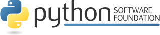

Tracked Robot Control Studio & Telemetry Monitor
------------------------------------------------

**botracked** is a modular Python desktop application, telemetry monitor, and mission scripting suite for tracked robotic platforms.

Developed in `python <https://www.python.org/>`_ code.

The README is used to introduce the tool and provide instructions on
how to install the tool, any machine dependencies it may have and any
other information that should be provided before the tool is installed.

|botracked python checker| |botracked python package| |botracked interface checker| |botracked isp checker| |botracked srp checker| |gplv3 license| |apache license| |python version| |github issues| |documentation status| |github contributors|

.. |botracked python checker| image:: https://github.com/vroncevic/botracked/actions/workflows/botracked_python_checker.yml/badge.svg
   :target: https://github.com/vroncevic/botracked/actions/workflows/botracked_python_checker.yml

.. |botracked python package| image:: https://github.com/vroncevic/botracked/actions/workflows/botracked_package_checker.yml/badge.svg
   :target: https://github.com/vroncevic/botracked/actions/workflows/botracked_package.yml

.. |botracked interface checker| image:: https://github.com/vroncevic/botracked/actions/workflows/botracked_interface_checker.yml/badge.svg
   :target: https://github.com/vroncevic/botracked/actions/workflows/botracked_interface_checker.yml

.. |botracked isp checker| image:: https://github.com/vroncevic/botracked/actions/workflows/botracked_isp_checker.yml/badge.svg
   :target: https://github.com/vroncevic/botracked/actions/workflows/botracked_isp_checker.yml

.. |botracked srp checker| image:: https://github.com/vroncevic/botracked/actions/workflows/botracked_srp_checker.yml/badge.svg
   :target: https://github.com/vroncevic/botracked/actions/workflows/botracked_srp_checker.yml

.. |gplv3 license| image:: https://img.shields.io/badge/License-GPLv3-blue.svg
   :target: https://www.gnu.org/licenses/gpl-3.0

.. |apache license| image:: https://img.shields.io/badge/License-Apache%202.0-blue.svg
   :target: https://opensource.org/licenses/Apache-2.0

.. |python version| image:: https://img.shields.io/badge/python-3.10+-blue.svg
   :target: https://www.python.org/downloads/

.. |github issues| image:: https://img.shields.io/github/issues/vroncevic/botracked.svg
   :target: https://github.com/vroncevic/botracked/issues

.. |github contributors| image:: https://img.shields.io/github/contributors/vroncevic/botracked.svg
   :target: https://github.com/vroncevic/botracked/graphs/contributors

.. |documentation status| image:: https://readthedocs.org/projects/botracked/badge/?version=latest
   :target: https://botracked.readthedocs.io/en/latest/?badge=latest

.. toctree::
   :maxdepth: 4
   :caption: Contents

   self
   modules

🚀 Installation
---------------

|botracked python3 build|

.. |botracked python3 build| image:: https://github.com/vroncevic/botracked/actions/workflows/botracked_python3_build.yml/badge.svg
   :target: https://github.com/vroncevic/botracked/actions/workflows/botracked_python3_build.yml

Navigate to release `page`_ download and extract release archive.

.. _page: https://github.com/vroncevic/botracked/releases

To install **botracked** type the following

.. code-block:: bash

    tar xvzf botracked-x.y.z.tar.gz
    cd botracked-x.y.z/
    # python3
    wget https://bootstrap.pypa.io/get-pip.py
    python3 get-pip.py 
    python3 -m pip install --upgrade setuptools
    python3 -m pip install --upgrade pip
    python3 -m pip install --upgrade build
    pip3 install -r requirements.txt
    python3 -m build --no-isolation --wheel
    pip3 install ./dist/botracked-*-py3-none-any.whl
    rm -f get-pip.py
    chmod 755 /usr/local/lib/python3.10/dist-packages/usr/local/bin/botracked_run.py
    ln -s /usr/local/lib/python3.10/dist-packages/usr/local/bin/botracked_run.py /usr/local/bin/botracked_run.py

You can use Docker to create image/container, or You can use pip to install

.. code-block:: bash

    # python3
    pip3 install botracked

📦 Dependencies
---------------

**botracked** requires next modules and libraries

* `ats-utilities - Python App/Tool/Script Utilities <https://pypi.org/project/ats-utilities/>`_ |ats gplv3| |ats apache|
* `pyserial - Python Serial Port Extension <https://pypi.org/project/pyserial/>`_ |pyserial bsd|

.. |ats gplv3| image:: https://img.shields.io/badge/License-GPLv3-blue.svg
   :target: https://www.gnu.org/licenses/gpl-3.0

.. |ats apache| image:: https://img.shields.io/badge/License-Apache%202.0-blue.svg
   :target: https://opensource.org/licenses/Apache-2.0

.. |pyserial bsd| image:: https://img.shields.io/badge/License-BSD_3--Clause-blue.svg
   :target: https://opensource.org/licenses/BSD-3-Clause

📁 Tool structure
-----------------

**botracked** is based on OOP and Clean Architecture.

Tool structure

.. code-block:: bash

    botracked/
         ├── core/
         │   ├── __init__.py
         │   ├── model/
         │   │   ├── connection_params.py
         │   │   ├── connection_preference.py
         │   │   ├── dsl/
         │   │   │   ├── ast_instruction.py
         │   │   │   ├── compiled_step.py
         │   │   │   ├── __init__.py
         │   │   │   ├── token.py
         │   │   │   └── token_type.py
         │   │   ├── exceptions/
         │   │   │   ├── botracked_error.py
         │   │   │   ├── codec_error.py
         │   │   │   ├── connection_error.py
         │   │   │   ├── dsl_error.py
         │   │   │   ├── dsl_syntax_error.py
         │   │   │   ├── port_disconnected_error.py
         │   │   │   ├── preferences_error.py
         │   │   │   ├── preset_error.py
         │   │   │   ├── queue_empty_error.py
         │   │   │   ├── receiver_error.py
         │   │   │   └── transmitter_error.py
         │   │   ├── __init__.py
         │   │   ├── motion_command.py
         │   │   ├── motor_state.py
         │   │   ├── packet_direction.py
         │   │   ├── protocol_opcode.py
         │   │   ├── system_mode.py
         │   │   └── telemetry_data.py
         │   └── service/
         │       ├── bundle/
         │       │   ├── __init__.py
         │       │   ├── runners.py
         │       │   ├── runtime.py
         │       │   └── services.py
         │       ├── codec/
         │       │   ├── crc/
         │       │   │   ├── icalculator.py
         │       │   │   └── __init__.py
         │       │   ├── icodec.py
         │       │   └── __init__.py
         │       ├── concurrency/
         │       │   ├── iclock.py
         │       │   ├── icontroller.py
         │       │   ├── iflag.py
         │       │   ├── __init__.py
         │       │   ├── irunnable.py
         │       │   └── irunner.py
         │       ├── connection/
         │       │   ├── buffer/
         │       │   │   ├── __init__.py
         │       │   │   └── iqueue.py
         │       │   ├── dependencies.py
         │       │   ├── dispatcher/
         │       │   │   ├── dependencies.py
         │       │   │   ├── dispatcher.py
         │       │   │   ├── factory.py
         │       │   │   ├── idispatcher.py
         │       │   │   ├── __init__.py
         │       │   │   └── provides.py
         │       │   ├── factory.py
         │       │   ├── __init__.py
         │       │   ├── iservice.py
         │       │   ├── port/
         │       │   │   ├── __init__.py
         │       │   │   ├── iport.py
         │       │   │   └── istatus.py
         │       │   ├── preferences/
         │       │   │   ├── __init__.py
         │       │   │   └── irepository.py
         │       │   ├── provides.py
         │       │   ├── receiver/
         │       │   │   ├── dependencies.py
         │       │   │   ├── factory.py
         │       │   │   ├── __init__.py
         │       │   │   ├── protocol/
         │       │   │   │   ├── __init__.py
         │       │   │   │   ├── ireader.py
         │       │   │   │   └── ireceiver.py
         │       │   │   ├── provides.py
         │       │   │   └── task.py
         │       │   ├── scanner/
         │       │   │   ├── __init__.py
         │       │   │   └── iscanner.py
         │       │   ├── service.py
         │       │   ├── transmitter/
         │       │   │   ├── dependencies.py
         │       │   │   ├── factory.py
         │       │   │   ├── __init__.py
         │       │   │   ├── protocol/
         │       │   │   │   ├── __init__.py
         │       │   │   │   ├── itransmitter.py
         │       │   │   │   └── iwriter.py
         │       │   │   ├── provides.py
         │       │   │   └── task.py
         │       │   └── worker/
         │       │       ├── dependencies.py
         │       │       ├── factory.py
         │       │       ├── __init__.py
         │       │       ├── iworker.py
         │       │       ├── loop/
         │       │       │   ├── iloop.py
         │       │       │   ├── __init__.py
         │       │       │   └── loop.py
         │       │       ├── provides.py
         │       │       ├── task/
         │       │       │   ├── __init__.py
         │       │       │   ├── itask.py
         │       │       │   └── task.py
         │       │       └── worker.py
         │       ├── dsl/
         │       │   ├── compiler/
         │       │   │   ├── compiler.py
         │       │   │   ├── dependencies.py
         │       │   │   ├── estimator/
         │       │   │   │   ├── estimator.py
         │       │   │   │   ├── iestimator.py
         │       │   │   │   └── __init__.py
         │       │   │   ├── factory.py
         │       │   │   ├── icompiler.py
         │       │   │   ├── __init__.py
         │       │   │   ├── motion/
         │       │   │   │   ├── imotion.py
         │       │   │   │   ├── __init__.py
         │       │   │   │   └── motion.py
         │       │   │   ├── node/
         │       │   │   │   ├── __init__.py
         │       │   │   │   ├── inode.py
         │       │   │   │   ├── node.py
         │       │   │   │   └── state.py
         │       │   │   └── provides.py
         │       │   ├── dependencies.py
         │       │   ├── factory.py
         │       │   ├── __init__.py
         │       │   ├── iservice.py
         │       │   ├── lexer/
         │       │   │   ├── factory.py
         │       │   │   ├── identifier/
         │       │   │   │   ├── identifier.py
         │       │   │   │   ├── iidentifier.py
         │       │   │   │   └── __init__.py
         │       │   │   ├── ilexer.py
         │       │   │   ├── __init__.py
         │       │   │   ├── lexer.py
         │       │   │   ├── number/
         │       │   │   │   ├── __init__.py
         │       │   │   │   ├── inumber.py
         │       │   │   │   └── number.py
         │       │   │   └── provides.py
         │       │   ├── parser/
         │       │   │   ├── cursor/
         │       │   │   │   ├── cursor.py
         │       │   │   │   ├── icursor.py
         │       │   │   │   └── __init__.py
         │       │   │   ├── factory.py
         │       │   │   ├── __init__.py
         │       │   │   ├── iparser.py
         │       │   │   ├── parser.py
         │       │   │   ├── provides.py
         │       │   │   └── statement/
         │       │   │       ├── __init__.py
         │       │   │       ├── istatement.py
         │       │   │       └── statement.py
         │       │   ├── preset/
         │       │   │   ├── __init__.py
         │       │   │   └── irepository.py
         │       │   ├── provides.py
         │       │   └── service.py
         │       ├── __init__.py
         │       ├── motion/
         │       │   ├── dependencies.py
         │       │   ├── factory.py
         │       │   ├── __init__.py
         │       │   ├── iservice.py
         │       │   ├── protocol/
         │       │   │   ├── iactuator.py
         │       │   │   └── __init__.py
         │       │   ├── provides.py
         │       │   ├── runner/
         │       │   │   ├── dependencies.py
         │       │   │   ├── factory.py
         │       │   │   ├── __init__.py
         │       │   │   ├── irunner.py
         │       │   │   ├── pacer/
         │       │   │   │   ├── dependencies.py
         │       │   │   │   ├── factory.py
         │       │   │   │   ├── __init__.py
         │       │   │   │   ├── ipacer.py
         │       │   │   │   ├── pacer.py
         │       │   │   │   └── provides.py
         │       │   │   ├── provides.py
         │       │   │   ├── runner.py
         │       │   │   └── worker/
         │       │   │       ├── dependencies.py
         │       │   │       ├── factory.py
         │       │   │       ├── __init__.py
         │       │   │       ├── iworker.py
         │       │   │       ├── provides.py
         │       │   │       └── worker.py
         │       │   └── service.py
         │       └── telemetry/
         │           ├── factory.py
         │           ├── __init__.py
         │           ├── inspector/
         │           │   ├── dependencies.py
         │           │   ├── factory.py
         │           │   ├── iinspector.py
         │           │   ├── __init__.py
         │           │   ├── inspector.py
         │           │   └── provides.py
         │           ├── iservice.py
         │           ├── listener/
         │           │   ├── decoder/
         │           │   │   ├── decoder.py
         │           │   │   ├── idecoder.py
         │           │   │   └── __init__.py
         │           │   ├── dependencies.py
         │           │   ├── factory.py
         │           │   ├── ilistener.py
         │           │   ├── __init__.py
         │           │   ├── listener.py
         │           │   ├── loop/
         │           │   │   ├── iloop.py
         │           │   │   ├── __init__.py
         │           │   │   └── loop.py
         │           │   └── provides.py
         │           ├── poller/
         │           │   ├── dependencies.py
         │           │   ├── factory.py
         │           │   ├── __init__.py
         │           │   ├── ipoller.py
         │           │   ├── loop/
         │           │   │   ├── iloop.py
         │           │   │   ├── __init__.py
         │           │   │   └── loop.py
         │           │   ├── poller.py
         │           │   └── provides.py
         │           ├── protocol/
         │           │   ├── __init__.py
         │           │   ├── iobserver.py
         │           │   └── isink.py
         │           ├── provides.py
         │           └── service.py
         ├── engine.py
         ├── infrastructure/
         │   ├── cli/
         │   │   ├── dependencies.py
         │   │   ├── engine.py
         │   │   ├── factory.py
         │   │   ├── icli.py
         │   │   ├── __init__.py
         │   │   ├── provides.py
         │   │   └── setup/
         │   │       ├── bundle.py
         │   │       ├── dep_validator.py
         │   │       ├── dependencies.py
         │   │       ├── factory.py
         │   │       ├── __init__.py
         │   │       ├── keys.py
         │   │       ├── opt_validator.py
         │   │       ├── options.py
         │   │       ├── registry.py
         │   │       └── validator.py
         │   ├── codec/
         │   │   ├── codec.py
         │   │   ├── crc/
         │   │   │   ├── calculator.py
         │   │   │   ├── dependencies.py
         │   │   │   ├── factory.py
         │   │   │   ├── __init__.py
         │   │   │   └── provides.py
         │   │   ├── dependencies.py
         │   │   ├── factory.py
         │   │   ├── __init__.py
         │   │   └── provides.py
         │   ├── command/
         │   │   ├── bundle.py
         │   │   ├── definition.py
         │   │   ├── dependencies.py
         │   │   ├── executor.py
         │   │   ├── factory.py
         │   │   ├── idefinition.py
         │   │   ├── iexecutor.py
         │   │   ├── __init__.py
         │   │   ├── ipreloader.py
         │   │   ├── preloader.py
         │   │   └── provides.py
         │   ├── concurrency/
         │   │   ├── clock/
         │   │   │   ├── clock.py
         │   │   │   ├── factory.py
         │   │   │   ├── __init__.py
         │   │   │   └── provides.py
         │   │   ├── controller/
         │   │   │   ├── controller.py
         │   │   │   ├── dependencies.py
         │   │   │   ├── factory.py
         │   │   │   ├── __init__.py
         │   │   │   └── provides.py
         │   │   ├── flag/
         │   │   │   ├── factory.py
         │   │   │   ├── __init__.py
         │   │   │   └── provides.py
         │   │   ├── __init__.py
         │   │   └── runner/
         │   │       ├── cycle/
         │   │       │   ├── cycle.py
         │   │       │   ├── icycle.py
         │   │       │   └── __init__.py
         │   │       ├── dependencies.py
         │   │       ├── factory.py
         │   │       ├── iexecutor.py
         │   │       ├── __init__.py
         │   │       ├── provides.py
         │   │       └── runner.py
         │   ├── config/
         │   │   ├── botracked.cfg
         │   │   └── botracked.logo
         │   ├── connection/
         │   │   ├── buffer/
         │   │   │   ├── byte_queue.py
         │   │   │   ├── dependencies.py
         │   │   │   ├── factory.py
         │   │   │   ├── __init__.py
         │   │   │   ├── iraw_queue.py
         │   │   │   └── provides.py
         │   │   ├── driver/
         │   │   │   ├── control.py
         │   │   │   ├── dependencies.py
         │   │   │   ├── driver.py
         │   │   │   ├── factory.py
         │   │   │   ├── idriver.py
         │   │   │   ├── ilock.py
         │   │   │   ├── __init__.py
         │   │   │   ├── iraw_control.py
         │   │   │   ├── iraw_io.py
         │   │   │   └── provides.py
         │   │   ├── __init__.py
         │   │   ├── port/
         │   │   │   ├── dependencies.py
         │   │   │   ├── factory.py
         │   │   │   ├── __init__.py
         │   │   │   ├── provides.py
         │   │   │   └── serial.py
         │   │   ├── preferences/
         │   │   │   ├── dependencies.py
         │   │   │   ├── factory.py
         │   │   │   ├── __init__.py
         │   │   │   ├── istorage.py
         │   │   │   ├── provides.py
         │   │   │   ├── repository.py
         │   │   │   └── storage.py
         │   │   ├── receiver/
         │   │   │   ├── dependencies.py
         │   │   │   ├── factory.py
         │   │   │   ├── __init__.py
         │   │   │   ├── provides.py
         │   │   │   └── serial.py
         │   │   ├── scanner/
         │   │   │   ├── dependencies.py
         │   │   │   ├── factory.py
         │   │   │   ├── __init__.py
         │   │   │   ├── provides.py
         │   │   │   └── scanner.py
         │   │   └── transmitter/
         │   │       ├── dependencies.py
         │   │       ├── factory.py
         │   │       ├── __init__.py
         │   │       ├── provides.py
         │   │       └── serial.py
         │   ├── gui/
         │   │   ├── connection/
         │   │   │   ├── adapter/
         │   │   │   │   ├── adapter.py
         │   │   │   │   ├── dependencies.py
         │   │   │   │   ├── factory.py
         │   │   │   │   ├── __init__.py
         │   │   │   │   └── provides.py
         │   │   │   ├── dependencies.py
         │   │   │   ├── factory.py
         │   │   │   ├── idelegate.py
         │   │   │   ├── __init__.py
         │   │   │   ├── ipanel.py
         │   │   │   ├── iport_delegate.py
         │   │   │   ├── panel.py
         │   │   │   ├── provides.py
         │   │   │   ├── serial/
         │   │   │   │   ├── dependencies.py
         │   │   │   │   ├── factory.py
         │   │   │   │   ├── __init__.py
         │   │   │   │   ├── isection.py
         │   │   │   │   ├── provides.py
         │   │   │   │   └── section.py
         │   │   │   └── status/
         │   │   │       ├── dependencies.py
         │   │   │       ├── factory.py
         │   │   │       ├── ilistener.py
         │   │   │       ├── __init__.py
         │   │   │       ├── isection.py
         │   │   │       ├── provides.py
         │   │   │       └── section.py
         │   │   ├── console/
         │   │   │   ├── dependencies.py
         │   │   │   ├── factory.py
         │   │   │   ├── __init__.py
         │   │   │   ├── ipanel.py
         │   │   │   ├── observer/
         │   │   │   │   ├── ilistener.py
         │   │   │   │   ├── __init__.py
         │   │   │   │   └── isink.py
         │   │   │   ├── panel.py
         │   │   │   ├── provides.py
         │   │   │   ├── stream/
         │   │   │   │   ├── dependencies.py
         │   │   │   │   ├── factory.py
         │   │   │   │   ├── __init__.py
         │   │   │   │   ├── isection.py
         │   │   │   │   ├── provides.py
         │   │   │   │   └── section.py
         │   │   │   └── toolbar/
         │   │   │       ├── dependencies.py
         │   │   │       ├── factory.py
         │   │   │       ├── __init__.py
         │   │   │       ├── isection.py
         │   │   │       ├── provides.py
         │   │   │       └── section.py
         │   │   ├── igui.py
         │   │   ├── __init__.py
         │   │   ├── layout/
         │   │   │   ├── builder.py
         │   │   │   ├── bundle.py
         │   │   │   ├── dependencies.py
         │   │   │   ├── factory.py
         │   │   │   ├── ibuilder.py
         │   │   │   ├── __init__.py
         │   │   │   ├── provides.py
         │   │   │   └── slots.py
         │   │   ├── lifecycle/
         │   │   │   ├── dependencies.py
         │   │   │   ├── factory.py
         │   │   │   ├── __init__.py
         │   │   │   ├── irunner.py
         │   │   │   ├── provides.py
         │   │   │   └── runner.py
         │   │   ├── mission/
         │   │   │   ├── adapter/
         │   │   │   │   ├── adapter.py
         │   │   │   │   ├── dependencies.py
         │   │   │   │   ├── factory.py
         │   │   │   │   ├── __init__.py
         │   │   │   │   └── provides.py
         │   │   │   ├── dependencies.py
         │   │   │   ├── editor/
         │   │   │   │   ├── dependencies.py
         │   │   │   │   ├── factory.py
         │   │   │   │   ├── __init__.py
         │   │   │   │   ├── isection.py
         │   │   │   │   ├── provides.py
         │   │   │   │   └── section.py
         │   │   │   ├── factory.py
         │   │   │   ├── idelegate.py
         │   │   │   ├── __init__.py
         │   │   │   ├── ipanel.py
         │   │   │   ├── panel.py
         │   │   │   ├── playback/
         │   │   │   │   ├── dependencies.py
         │   │   │   │   ├── factory.py
         │   │   │   │   ├── __init__.py
         │   │   │   │   ├── isection.py
         │   │   │   │   ├── provides.py
         │   │   │   │   └── section.py
         │   │   │   ├── preset/
         │   │   │   │   ├── dependencies.py
         │   │   │   │   ├── factory.py
         │   │   │   │   ├── __init__.py
         │   │   │   │   ├── isection.py
         │   │   │   │   ├── provides.py
         │   │   │   │   └── section.py
         │   │   │   ├── provides.py
         │   │   │   ├── status/
         │   │   │   │   ├── dependencies.py
         │   │   │   │   ├── factory.py
         │   │   │   │   ├── __init__.py
         │   │   │   │   ├── isection.py
         │   │   │   │   ├── provides.py
         │   │   │   │   └── section.py
         │   │   │   ├── syntax/
         │   │   │   │   ├── config.py
         │   │   │   │   ├── dependencies.py
         │   │   │   │   ├── factory.py
         │   │   │   │   ├── highlighter/
         │   │   │   │   │   ├── highlighter.py
         │   │   │   │   │   ├── ihighlighter.py
         │   │   │   │   │   └── __init__.py
         │   │   │   │   ├── __init__.py
         │   │   │   │   ├── matcher/
         │   │   │   │   │   ├── imatcher.py
         │   │   │   │   │   ├── __init__.py
         │   │   │   │   │   └── matcher.py
         │   │   │   │   └── provides.py
         │   │   │   └── toolbar/
         │   │   │       ├── dependencies.py
         │   │   │       ├── factory.py
         │   │   │       ├── __init__.py
         │   │   │       ├── isection.py
         │   │   │       ├── provides.py
         │   │   │       └── section.py
         │   │   ├── motion/
         │   │   │   ├── adapter/
         │   │   │   │   ├── adapter.py
         │   │   │   │   ├── dependencies.py
         │   │   │   │   ├── factory.py
         │   │   │   │   ├── __init__.py
         │   │   │   │   └── provides.py
         │   │   │   ├── dependencies.py
         │   │   │   ├── dpad/
         │   │   │   │   ├── dependencies.py
         │   │   │   │   ├── factory.py
         │   │   │   │   ├── __init__.py
         │   │   │   │   ├── isection.py
         │   │   │   │   ├── provides.py
         │   │   │   │   ├── section.py
         │   │   │   │   └── trigger/
         │   │   │   │       ├── __init__.py
         │   │   │   │       ├── itrigger.py
         │   │   │   │       └── trigger.py
         │   │   │   ├── factory.py
         │   │   │   ├── idelegate.py
         │   │   │   ├── __init__.py
         │   │   │   ├── ipanel.py
         │   │   │   ├── keyboard/
         │   │   │   │   ├── controller/
         │   │   │   │   │   ├── controller.py
         │   │   │   │   │   ├── icontroller.py
         │   │   │   │   │   └── __init__.py
         │   │   │   │   ├── dependencies.py
         │   │   │   │   ├── factory.py
         │   │   │   │   ├── __init__.py
         │   │   │   │   └── provides.py
         │   │   │   ├── panel.py
         │   │   │   ├── provides.py
         │   │   │   └── speed/
         │   │   │       ├── dependencies.py
         │   │   │       ├── factory.py
         │   │   │       ├── __init__.py
         │   │   │       ├── isection.py
         │   │   │       ├── provides.py
         │   │   │       └── section.py
         │   │   ├── session/
         │   │   │   ├── dependencies.py
         │   │   │   ├── factory.py
         │   │   │   ├── __init__.py
         │   │   │   ├── isession.py
         │   │   │   ├── provides.py
         │   │   │   └── session.py
         │   │   ├── telemetry/
         │   │   │   ├── card/
         │   │   │   │   ├── dependencies.py
         │   │   │   │   ├── factory.py
         │   │   │   │   ├── __init__.py
         │   │   │   │   ├── isection.py
         │   │   │   │   ├── provides.py
         │   │   │   │   └── section.py
         │   │   │   ├── config.py
         │   │   │   ├── dependencies.py
         │   │   │   ├── factory.py
         │   │   │   ├── __init__.py
         │   │   │   ├── ipanel.py
         │   │   │   ├── iview.py
         │   │   │   ├── observer/
         │   │   │   │   ├── dependencies.py
         │   │   │   │   ├── factory.py
         │   │   │   │   ├── __init__.py
         │   │   │   │   ├── observer.py
         │   │   │   │   └── provides.py
         │   │   │   ├── panel.py
         │   │   │   └── provides.py
         │   │   ├── theme/
         │   │   │   ├── colors.py
         │   │   │   ├── controls/
         │   │   │   │   ├── controls.py
         │   │   │   │   ├── icontrols.py
         │   │   │   │   └── __init__.py
         │   │   │   ├── dependencies.py
         │   │   │   ├── factory.py
         │   │   │   ├── iconfigurator.py
         │   │   │   ├── __init__.py
         │   │   │   ├── provides.py
         │   │   │   └── style.py
         │   │   └── window/
         │   │       ├── config.py
         │   │       ├── configurator.py
         │   │       ├── dependencies.py
         │   │       ├── factory.py
         │   │       ├── iconfigurator.py
         │   │       ├── __init__.py
         │   │       └── provides.py
         │   ├── __init__.py
         │   └── preset/
         │       ├── dependencies.py
         │       ├── factory.py
         │       ├── __init__.py
         │       ├── provides.py
         │       └── repository.py
         ├── __init__.py
         └── setup/
             ├── bundle.py
             ├── dep_validator.py
             ├── dependencies.py
             ├── factory.py
             ├── gui/
             │   ├── cockpit/
             │   │   ├── dependencies.py
             │   │   ├── factory.py
             │   │   ├── __init__.py
             │   │   └── provides.py
             │   ├── connection/
             │   │   ├── dependencies.py
             │   │   ├── factory.py
             │   │   └── __init__.py
             │   ├── dependencies.py
             │   ├── factory.py
             │   ├── __init__.py
             │   ├── launcher.py
             │   └── mission/
             │       ├── dependencies.py
             │       ├── factory.py
             │       └── __init__.py
             ├── __init__.py
             ├── keys.py
             ├── opt_validator.py
             ├── options.py
             ├── registry.py
             ├── service/
             │   ├── connection.py
             │   ├── connection_provides.py
             │   ├── dsl.py
             │   ├── factory.py
             │   ├── __init__.py
             │   ├── mission.py
             │   ├── motion.py
             │   └── telemetry.py
             └── validator.py

     111 directories, 534 files

✨ Features
-----------

* **Hardware Serial Transport**: High-reliability USB Serial UART communication (``/dev/ttyUSB0`` @ 115200 baud) directly interfacing with onboard robot microcontroller.
* **Interactive Jog & Navigation Cockpit**: Real-time D-Pad buttons for Forward, Backward, Skid-Turns, In-Place Spins, and instant Emergency Stop with keyboard key bindings (``W``, ``A``, ``S``, ``D``, ``Q``, ``E``, ``Space``).
* **Tracked Robot Mission DSL (`.track`)**: Full declarative scripting pipeline featuring lexical tokenizer, syntax parser, AST builder, and binary opcode compiler with Step, Run, Pause, and Resume execution controls.
* **Real-Time Telemetry Dashboard**: Live monitoring of system operational mode (``NORMAL``, ``DEGRADED``, ``PANIC``), kinematic track speeds, hardware fault counters, motor lock status, and round-trip ping latency.
* **Terminal Packet Inspector**: Bi-directional packet visualizer logging raw TX/RX frames with sequence counters, opcode labels, hex payloads, and CRC-8 integrity verification.
* **Robust CRC-8 Dallas/Maxim Codec**: High-integrity binary packet framing protocol with start-of-frame synchronization, opcode mapping, dynamic payload lengths, and checksum verification.
* **Strict Quality & SOLID Standards**: 100% protocol conformity, zero ISP/SRP violations, $\ge 78\%$ test coverage, and 10.00 / 10.00 Pylint score.

🏗 Architecture & SOLID Principles
----------------------------------

**botracked** is built on a strictly decoupled, **Layered Clean Architecture** where presentation, domain models, mission execution services, and physical communication adapters are segregated through pure Python protocols:

* **S — Single Responsibility Principle (SRP)**:
  * Every module and class has exactly one clearly bounded reason to change.
  * GUI tabs are partitioned into focused subcomponents (panels, configs, callbacks, mediators).
  * Enforced by automated gate: strict limit of $\le 15$ methods per class across the entire codebase.
* **O — Open/Closed Principle (OCP)**:
  * The DSL parser, compiler, and binary codec are open for extension without modifying existing code.
  * New motion opcodes and instructions plug into dedicated handlers and registries dynamically.
* **L — Liskov Substitution Principle (LSP)**:
  * Pure structural subtyping via Python ``@runtime_checkable Protocol`` definitions. Concrete classes never inherit concrete logic, ensuring complete interchangeability.
* **I — Interface Segregation Principle (ISP)**:
  * Clients depend only on the minimal interfaces they require (``IBotService``, ``IBotMotionService``, ``IBotTelemetryService``, ``IBotTransport``, ``IBinaryCodec``, ``ICrc8Calculator``).
* **D — Dependency Inversion Principle (DIP)**:
  * Core domain entities and services have zero dependencies on lower-level infrastructure (pyserial drivers, sockets, UI widgets). All dependencies are injected via protocols.

📜 Tracked Bot Domain-Specific Language (DSL)
---------------------------------------------

**botracked** includes a dedicated Domain-Specific Language designed for tracked mobile robots. Programs are written in plain text files with the ``.track`` extension:

.. list-table:: Tracked Bot DSL Instruction Reference
   :widths: 20 20 60
   :header-rows: 1

   * - Instruction & Syntax
     - Parameters
     - Description
   * - ``SPEED <pwm>``
     - ``60..255`` (PWM)
     - Sets target PWM velocity for subsequent motion commands.
   * - ``FORWARD [duration]``
     - Optional duration (e.g. ``2.0s``, ``500ms``)
     - Drives both tracks forward.
   * - ``BACKWARD [duration]``
     - Optional duration
     - Drives both tracks in reverse.
   * - ``TURN_LEFT [duration]``
     - Optional duration
     - Performs differential left skid-turn.
   * - ``TURN_RIGHT [duration]``
     - Optional duration
     - Performs differential right skid-turn.
   * - ``SPIN_LEFT [duration]``
     - Optional duration
     - Rotates in-place counter-clockwise.
   * - ``SPIN_RIGHT [duration]``
     - Optional duration
     - Rotates in-place clockwise.
   * - ``STOP``
     - None
     - Immediately commands kinematic deceleration to 0.
   * - ``WAIT <duration>``
     - Duration (e.g. ``1.5s``, ``250ms``)
     - Dwells execution for specified duration.
   * - ``PING``
     - None
     - Sends heartbeat frame to measure round-trip link latency.
   * - ``CLEAR_ERRORS``
     - None
     - Clears active error latches and resets fault counters.

📡 Binary Packet Communication Protocol
---------------------------------------

All communication between **botracked** and physical or virtual robot firmware uses a packetized binary protocol protected by Dallas/Maxim CRC-8:

* **Frame Layout**: ``[0xAA] [0x55] [OPCODE] [LEN] [PAYLOAD...] [CRC8]``
* **Synchronization**: Two-byte header ``0xAA 0x55``.
* **Opcode**: 1-byte command or response identifier.
* **Payload Length**: 1-byte payload byte count ($0 \dots 255$).
* **Checksum**: 1-byte CRC-8 computed over opcode, length, and payload.

📊 Code coverage
----------------

.. csv-table:: Code coverage
   :file: coverage_table.csv
   :widths: 60, 10, 10, 20
   :header-rows: 1

🛠 Usage
--------

Install package

.. code-block:: bash

    pip3 install botracked

Prepare main entry point by downloading `main.py` or create your own.

.. code-block:: bash

    wget -O main.py https://raw.githubusercontent.com/vroncevic/botracked/main/main.py

CLI Command Options
^^^^^^^^^^^^^^^^^^^

Launch the graphical studio with default configuration:

.. code-block:: bash

    python3 main.py studio

Launch with initial mission script and verbose logging:

.. code-block:: bash

    python3 main.py studio --file ./missions/patrol_demo.track --verbose enable

.. list-table:: Studio CLI Options
   :widths: 20 15 25 40
   :header-rows: 1

   * - Option
     - Type
     - Choices
     - Description
   * - **--file**
     - ``str``
     - *File path*
     - Path to initial mission script (``.track``) to load on startup.
   * - **--verbose**
     - ``str``
     - ``enable``, ``disable``
     - Enable or disable verbose ATS operational logging.

📚 Docs
-------

More documentation and info at

* `botracked.readthedocs.io <https://botracked.readthedocs.io>`_
* `www.python.org <https://www.python.org/>`_

👥 Contributing
---------------

`Contributing to botracked <https://github.com/vroncevic/botracked/blob/dev/CONTRIBUTING.md>`_

📄 Copyright and licence
-------------------------

Copyright (C) 2026 by `vroncevic.github.io/botracked <https://vroncevic.github.io/botracked>`_

**botracked** is free software; you can redistribute it and/or modify
it under the same terms as Python itself, either Python version 3.x or,
at your option, any later version of Python 3 you may have available.

Special thanks to **Google** and the Google developer ecosystem for their tremendous support and innovative tools from the Google bundle that empowered the development and realization of this project. *Google, you make this world a better place!* 🌍✨

Lets help and support PSF.

|python software foundation|

|donate|

.. |donate| image:: https://www.paypalobjects.com/en_US/i/btn/btn_donateCC_LG.gif
   :target: https://www.python.org/psf/donations/
